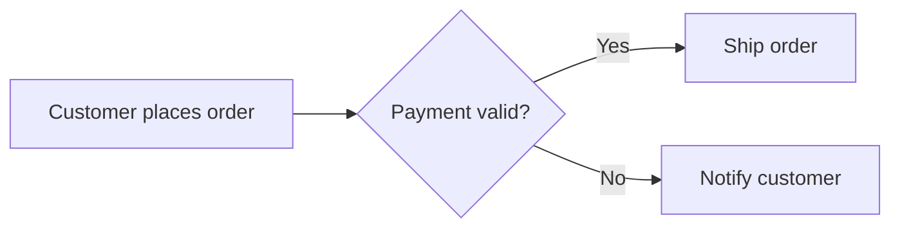
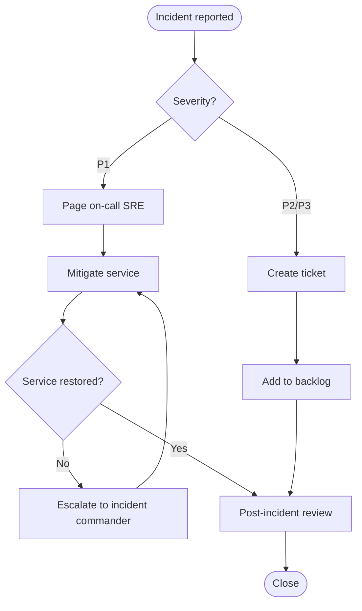
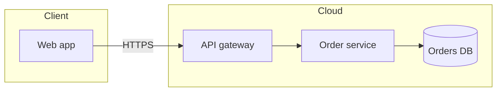

# Flowchart

Flowcharts show process steps, decisions, and flow of control.

## Simple example: order payment

## Complex example: incident handling with escalation

## Complex example: architecture with subgraphs

