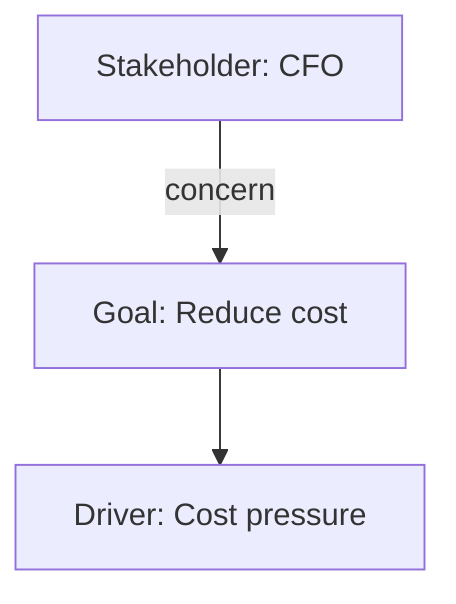
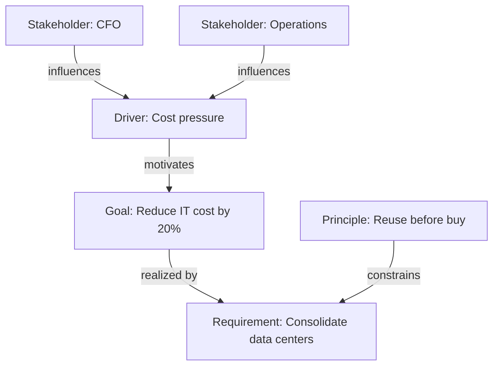

# Motivation viewpoint

ArchiMate viewpoint: Motivation. Mermaid type: `flowchart` (Approximate fit).

Mermaid has no ArchiMate support. Motivation elements (stakeholders, drivers, goals, requirements, principles) are drawn as labeled flowchart nodes.

## Description

Shows why the architecture exists: who cares (stakeholders), what pushes change (drivers), what is wanted (goals), what must be met (requirements), and which rules apply (principles).

## Example usages

- Linking stakeholder concerns to business goals
- Tracing requirements back to drivers
- Checking that principles constrain the chosen requirements
- Explaining architecture decisions to executives

## Example 1: Simple - Stakeholder concern drives a goal

## Example 2: Complex - Multiple drivers, goals, and principles

