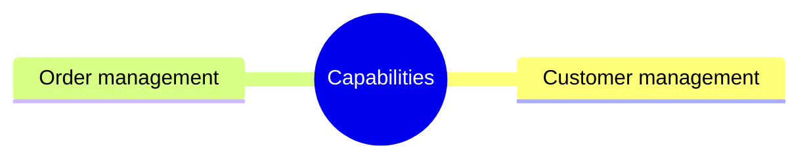
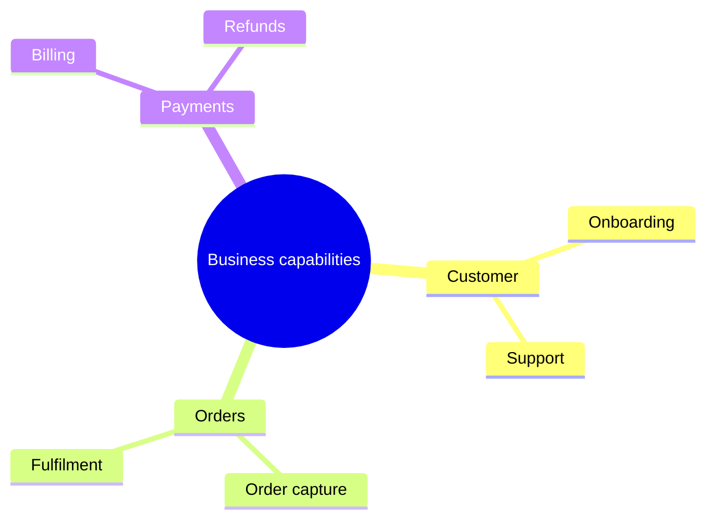

# Strategy capability viewpoint

ArchiMate viewpoint: Strategy (capability map). Mermaid type: `mindmap` (Approximate fit).

Mermaid has no ArchiMate support. A capability map is drawn as a hierarchical mindmap. Capability dependencies and maturity levels are not shown.

## Description

Hierarchical view of what the business is able to do, independent of how it is organized or which systems support it.

## Example usages

- Baseline of business capabilities for portfolio planning
- Finding capability overlaps across business units
- Prioritizing investment by capability
- Input for application-to-capability alignment

## Example 1: Simple - Top-level capabilities

## Example 2: Complex - Two levels of capabilities

