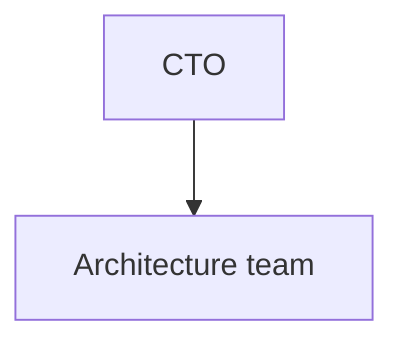
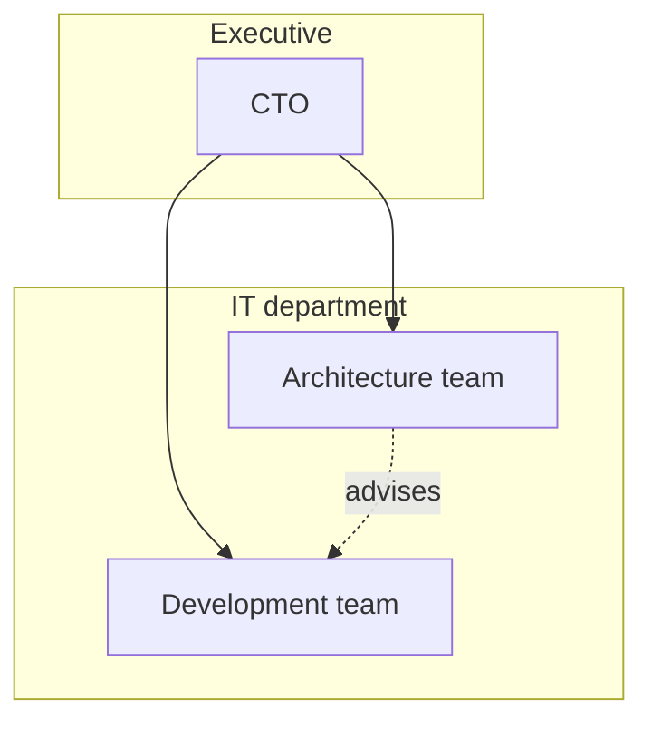

# Organization viewpoint

ArchiMate viewpoint: Organization. Mermaid type: `flowchart` (Approximate fit).

Mermaid has no ArchiMate support. Organization units and actors are drawn as flowchart subgraphs and nodes. Roles and collaborations are shown as plain edges.

## Description

Shows the structure of the enterprise: organizational units, actors, roles, and the relationships between them.

## Example usages

- Mapping which team owns which capability
- Showing reporting lines for architecture governance
- Identifying gaps in ownership before a change
- Preparing a RACI or responsibility discussion

## Example 1: Simple - Reporting line

## Example 2: Complex - Units with advisory relationship

