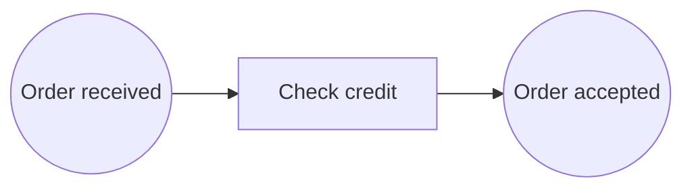
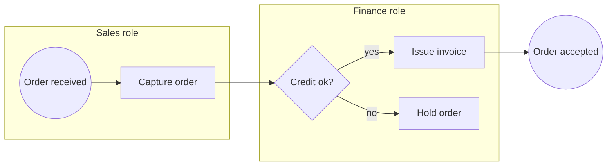

# Business process viewpoint

ArchiMate viewpoint: Business process. Mermaid type: `flowchart` (Close fit).

Business processes, events, and gateways map well to flowchart nodes. Role swimlanes are approximated with subgraphs.

## Description

Shows the sequence of business behavior, including events that start or end the process, business activities, and decisions, with the roles that perform them.

## Example usages

- Documenting order-to-cash or claims processes
- Showing handoffs between business roles
- Identifying decision points and exception paths
- Preparing process improvement workshops

## Example 1: Simple - Order acceptance

## Example 2: Complex - Handoff between sales and finance

