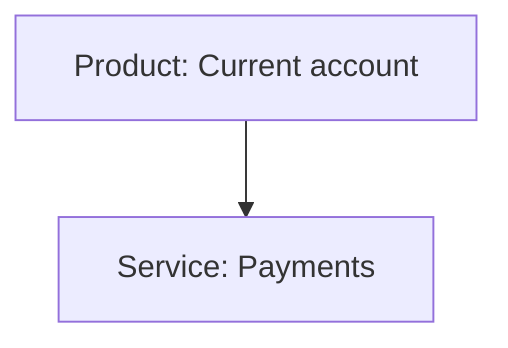
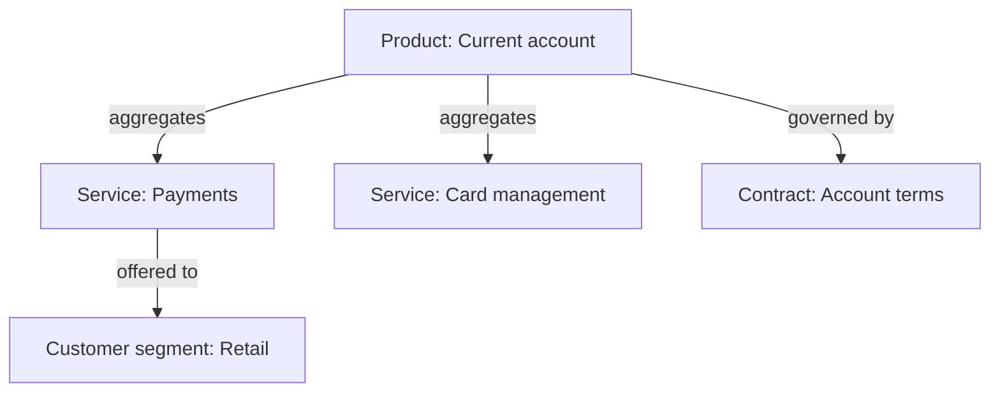

# Product viewpoint

ArchiMate viewpoint: Product. Mermaid type: `flowchart` (Approximate fit).

Mermaid has no ArchiMate support. Products, services, and contracts are drawn as labeled flowchart nodes with aggregation edges.

## Description

Shows a product as a bundle of business services and contracts, and the customer segments it is offered to.

## Example usages

- Mapping which services make up a product
- Showing contract terms that govern a product
- Comparing product offerings across customer segments
- Planning product changes and their impact on services

## Example 1: Simple - Product with one service

## Example 2: Complex - Product with services, contract, and segment

