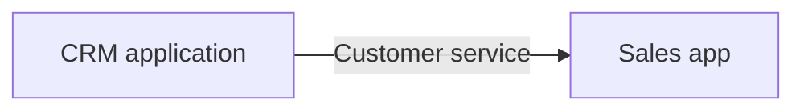
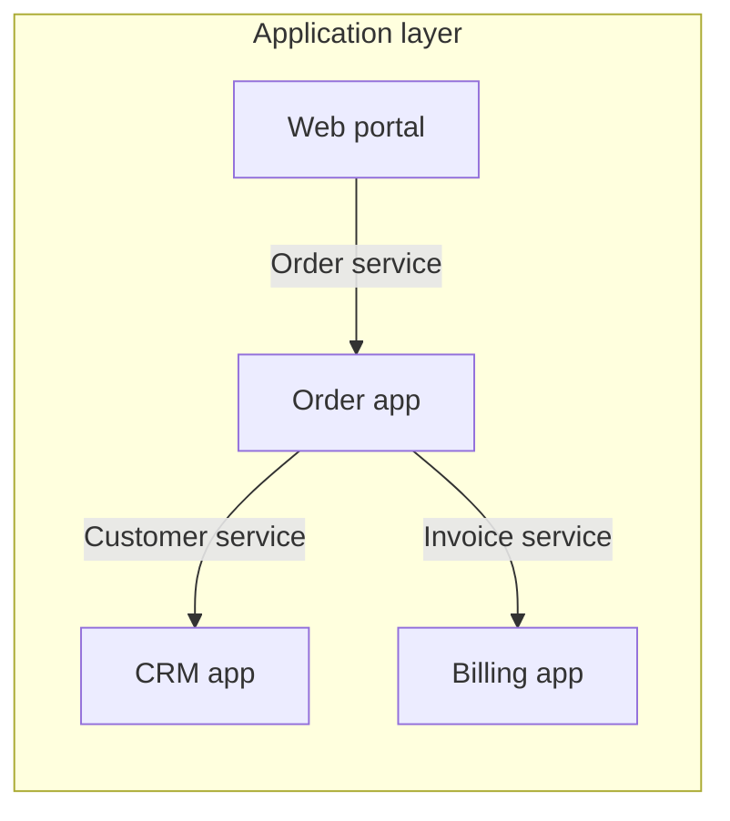

# Application cooperation viewpoint

ArchiMate viewpoint: Application cooperation. Mermaid type: `flowchart` (Approximate fit).

Mermaid has no ArchiMate support. Application components and services are drawn as flowchart nodes, and service use as labeled edges.

## Description

Shows how application components cooperate through application services and interfaces, without showing their internal structure.

## Example usages

- Mapping integration dependencies between applications
- Identifying which applications depend on a service that is being retired
- Showing the application landscape for a business domain
- Preparing an integration review

## Example 1: Simple - Two applications cooperating

## Example 2: Complex - Order application and its dependencies

