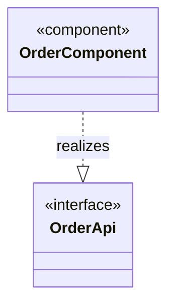
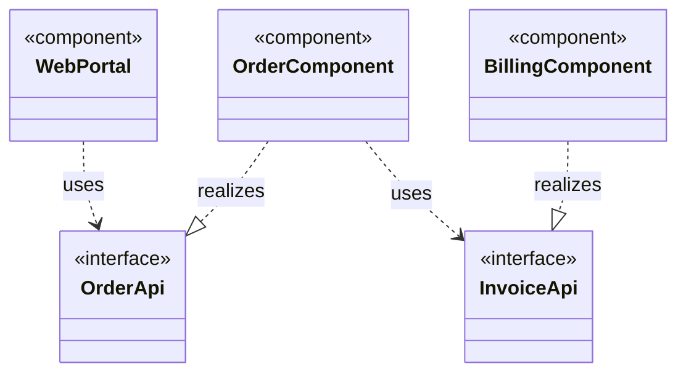

# Application structure viewpoint

ArchiMate viewpoint: Application structure. Mermaid type: `classDiagram` (Approximate fit).

Application components and interfaces map to class nodes with stereotype annotations. ArchiMate-specific notation is not supported.

## Description

Shows the internal structure of applications: components, the interfaces they provide and require, and the realization and usage relationships between them.

## Example usages

- Documenting which components provide and consume an interface
- Showing the module structure of a single application
- Reviewing coupling between components
- Planning the split of a component into smaller ones

## Example 1: Simple - Component providing an interface

## Example 2: Complex - Components with provided and required interfaces

