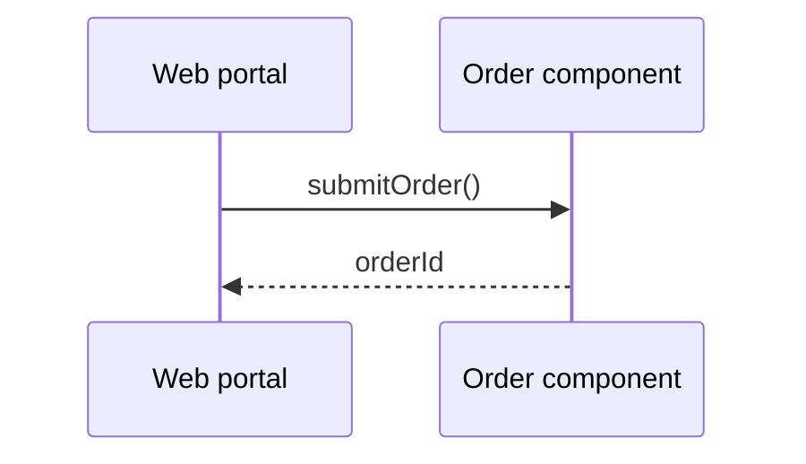
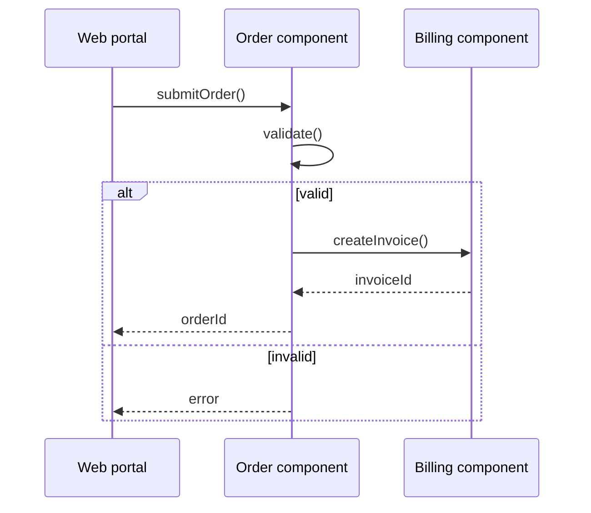

# Application behavior viewpoint

ArchiMate viewpoint: Application behavior. Mermaid type: `sequenceDiagram` (Approximate fit).

Application functions and processes are shown as message exchanges between components. ArchiMate's internal behavior elements are not modeled separately.

## Description

Shows how application behavior realizes business behavior: functions, processes, and events inside and between application components.

## Example usages

- Showing how an application function is executed step by step
- Linking business processes to application functions
- Describing validation and error paths in an application
- Documenting event-driven application behavior

## Example 1: Simple - Submit order

## Example 2: Complex - Validation and invoice creation

