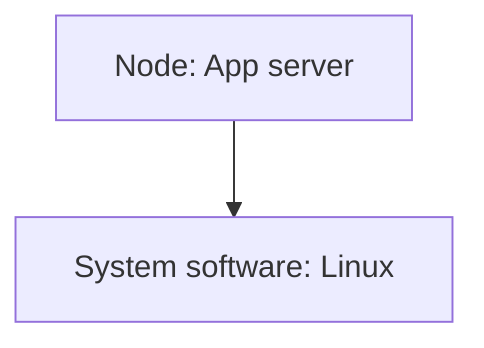
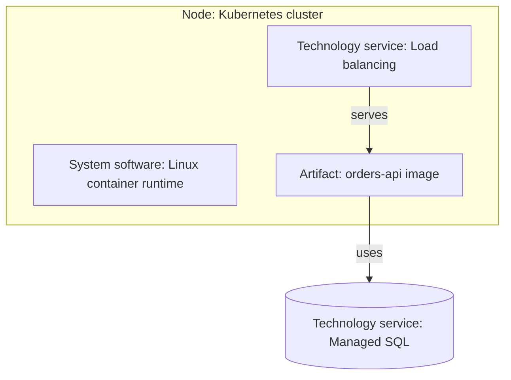

# Technology viewpoint

ArchiMate viewpoint: Technology. Mermaid type: `flowchart` (Approximate fit).

Mermaid has no ArchiMate support. Nodes, system software, technology services, and artifacts are drawn as flowchart subgraphs and nodes.

## Description

Shows the technology infrastructure: nodes, system software, technology services, and the artifacts deployed on them.

## Example usages

- Documenting the hosting platform for applications
- Showing which technology services an application depends on
- Planning infrastructure changes and their impact
- Mapping artifacts to nodes for operations handover

## Example 1: Simple - Node with system software

## Example 2: Complex - Cluster with services and managed database

