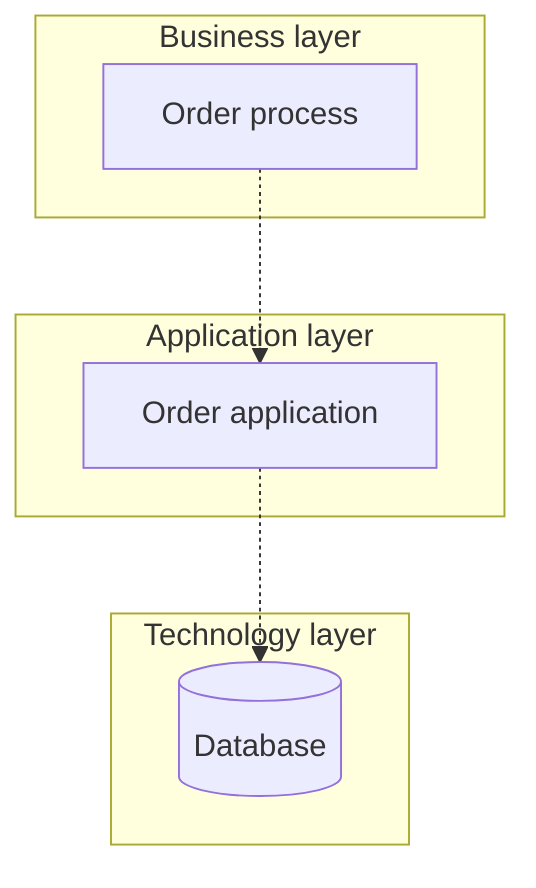
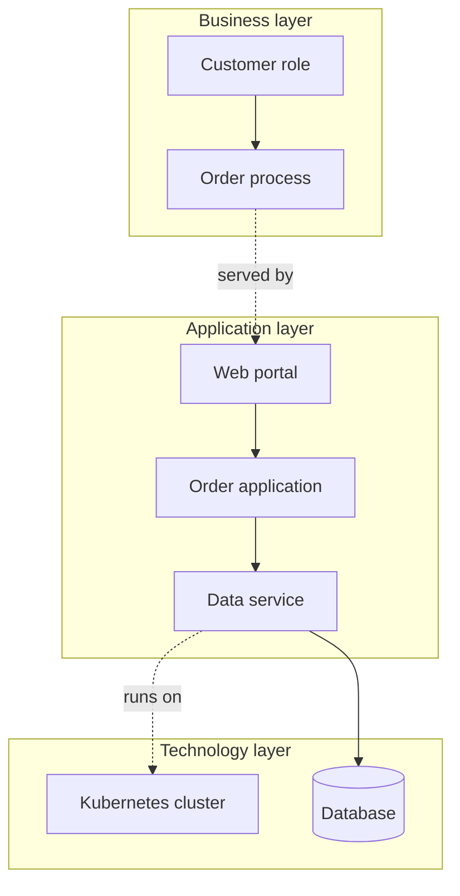

# Layered viewpoint

ArchiMate viewpoint: Layered. Mermaid type: `flowchart` (Close fit).

Business, application, and technology layers are drawn as subgraphs. Cross-layer relationships are shown as labeled edges.

## Description

Shows the business, application, and technology layers together, with the services that cross from one layer to the next.

## Example usages

- Giving an overview of the full architecture on one page
- Showing which technology supports which application service
- Explaining cross-layer dependencies to stakeholders
- Checking that every business process is supported by an application

## Example 1: Simple - Process supported by application and database

## Example 2: Complex - Full stack for order handling

