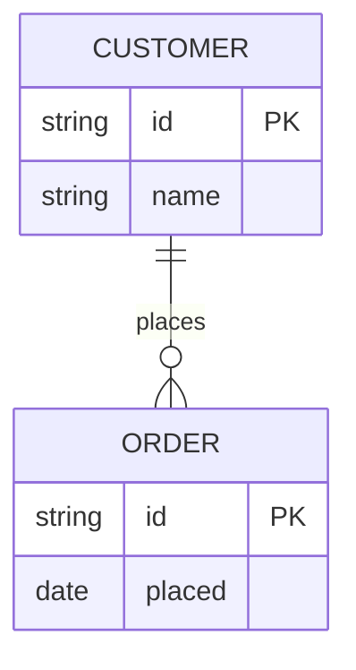
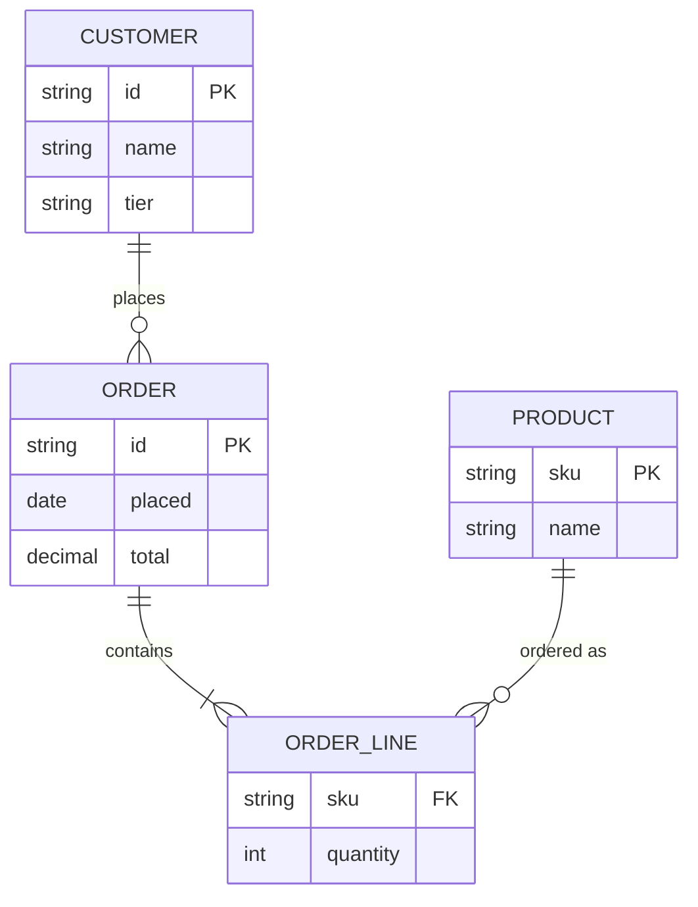

# Information structure viewpoint

ArchiMate viewpoint: Information structure. Mermaid type: `erDiagram` (Close fit).

Business objects and data objects map to entities, and their associations to relationships. ArchiMate aggregation and composition are approximated with cardinality.

## Description

Shows the information the architecture manages: business objects, their attributes, and how they relate to each other.

## Example usages

- Defining the core business objects for a domain
- Aligning data objects with the applications that use them
- Preparing data model reviews with business stakeholders
- Identifying shared information across applications

## Example 1: Simple - Customer and order

## Example 2: Complex - Order with lines and products

