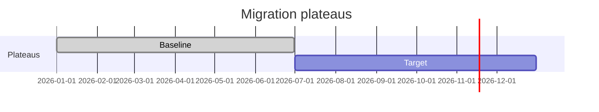
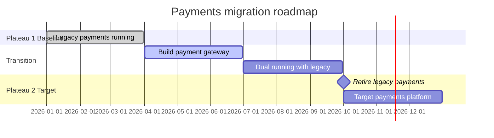

# Implementation and migration viewpoint

ArchiMate viewpoint: Implementation and migration (migration roadmap, plateaus). Mermaid type: `gantt` (Approximate fit).

Mermaid has no ArchiMate support. Plateaus and work packages are drawn as gantt sections and tasks. Plateau states and gaps between them are not modeled.

## Description

Shows how the architecture moves from the baseline to the target through transition states (plateaus), with work packages and milestones on a timeline.

## Example usages

- Planning a migration roadmap across plateaus
- Showing when a transition architecture is live
- Tracking work packages against plateaus
- Communicating milestones to programme boards

## Example 1: Simple - Baseline and target plateaus

## Example 2: Complex - Payments migration with transition work

