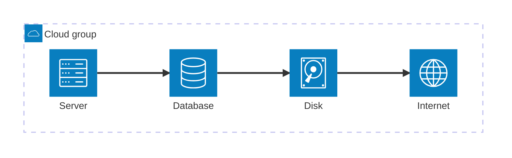

# Cloud Architecture

Mermaid type: `architecture-beta` (beta). Shows cloud services, regions, and network groups.

## Legend

### Built-in icons

Icons are set with `(name)` after the group or service id. Only these five are available without registering an icon pack.

| Icon | Name in code | Typical meaning | Used in this diagram |
|---|---|---|---|
| Cloud | `cloud` | Region, VNet, or boundary (usually a group) | Region EU, VNet 10.0.0.0/16 |
| Database | `database` | Relational or managed data store | Orders DB |
| Disk | `disk` | Block or object storage, backup | Blob storage |
| Internet | `internet` | External users or public internet | Internet |
| Server | `server` | Compute or network service (VM, app, load balancer) | Load balancer, Web app, Orders API |

Other icons (for example `logos:aws-s3`) need an icon pack registered in Mermaid config.

### Elements

| Element | Syntax | Used in this diagram |
|---|---|---|
| Group | `group id(icon)[Label] in parent` | Region EU, VNet |
| Service | `service id(icon)[Label] in group` | All nodes except Internet |
| Junction | `junction id` | No |

### Edges

| Syntax | Meaning |
|---|---|
| `a:R -- L:b` | Line from right side of `a` to left side of `b` |
| `a:R --> L:b` | Same, with arrowhead at `b` |
| `a:R <-- L:b` | Arrowhead at `a` |
| `a:R <--> L:b` | Arrowheads at both ends |
| `a:T`, `a:B`, `a:L`, `a:R` | Side of the service the edge leaves or enters |
| `a{group}:B --> T:b` | Edge leaving a group boundary (for services inside a group) |

### Layout

| Syntax | Meaning |
|---|---|
| `align row a b c` | Puts services on the same y-axis (v11.16.0+) |
| `align column a b` | Puts services on the same x-axis (v11.16.0+) |

### Visual reference

## Icon pack test (logos)

Prefix `logos:` plus the Iconify icon name, for example `logos:aws-lambda`.

```mermaid
architecture-beta
    group aws(logos:aws-ec2)[AWS account]

    service lb(logos:aws-elb)[Load balancer] in aws
    service api(logos:aws-api-gateway)[API gateway] in aws
    service fn(logos:aws-lambda)[Orders function] in aws
    service db(logos:aws-aurora)[Orders DB] in aws
    service store(logos:aws-s3)[Blob storage] in aws

    lb:R --> L:api
    api:R --> L:fn
    fn:B --> T:db
    fn:R --> L:store
```

### Legend: logos (Iconify)

Prefix `logos:` plus icon name. Bundled with the built-in preview, no setup needed.

| Icon name | Used in test diagram | Typical meaning |
|---|---|---|
| `logos:aws-ec2` | AWS account (group) | Compute instances |
| `logos:aws-elb` | Load balancer | Load balancing |
| `logos:aws-api-gateway` | API gateway | API entry point |
| `logos:aws-lambda` | Orders function | Serverless function |
| `logos:aws-aurora` | Orders DB | Relational database |
| `logos:aws-s3` | Blob storage | Object storage |

Other available icons: `logos:aws-cloudfront`, `logos:aws-rds`, `logos:aws-dynamodb`, `logos:aws-sqs`, `logos:aws-sns`, `logos:aws-ecs`, `logos:aws-eks`, `logos:aws-vpc`, `logos:aws-route53`, `logos:aws-iam`, `logos:aws-cloudwatch`, `logos:docker-icon`.

## Icon pack test (mdi)

Prefix `mdi:` plus icon name, for example `mdi:account`.

```mermaid
architecture-beta
    group dc(mdi:cloud)[Data center]

    service user(mdi:account)[Client]
    service fw(mdi:lock)[Firewall] in dc
    service web(mdi:web)[Web server] in dc
    service api(mdi:api)[API] in dc
    service db(mdi:database)[Database] in dc
    service disk(mdi:harddisk)[Backup disk] in dc

    user:R --> L:fw
    fw:R --> L:web
    web:B --> T:api
    api:B --> T:db
    db:R --> L:disk
```

### Legend: mdi (Material Design Icons)

Prefix `mdi:` plus icon name. Bundled with the built-in preview, no setup needed.

| Icon name | Used in test diagram | Typical meaning |
|---|---|---|
| `mdi:cloud` | Data center (group) | Boundary or environment |
| `mdi:account` | Client | User or external actor |
| `mdi:lock` | Firewall | Security control |
| `mdi:web` | Web server | Web tier |
| `mdi:api` | API | Service interface |
| `mdi:database` | Database | Data store |
| `mdi:harddisk` | Backup disk | Disk storage |

Other available icons: `mdi:server`, `mdi:lan`, `mdi:router`, `mdi:cog`.
