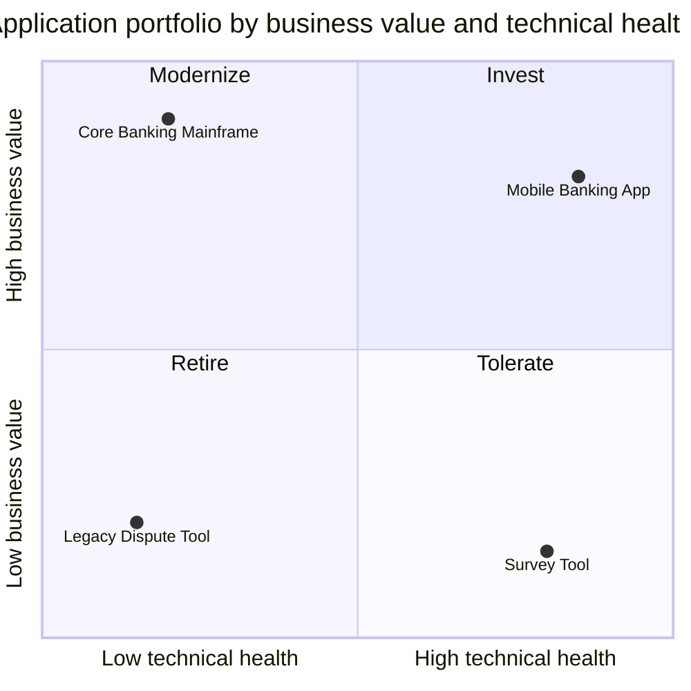
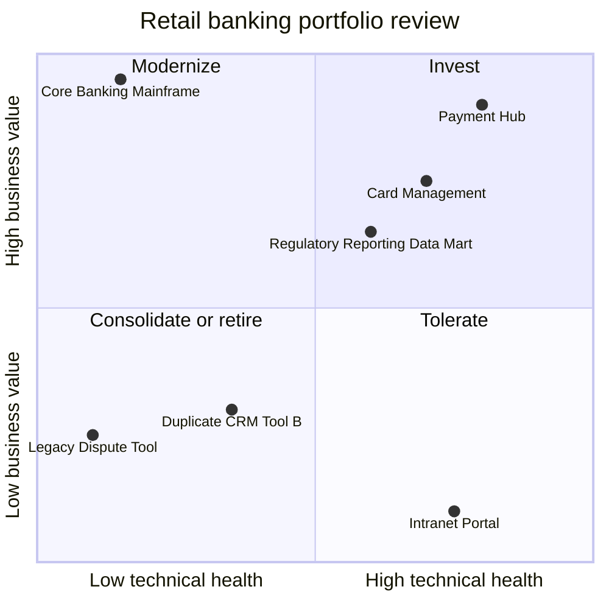

# Application Portfolio Map

Mermaid type: `quadrantChart` (Close fit). Source: Modeling-Diagraming.md, section "Enterprise Architecture & Business Strategy".

Visualizes applications by business importance and technical health to show which applications to invest in, modernize, consolidate, or retire.

## Example 1: Simple - value vs technical health

## Example 2: Realistic - retail banking portfolio review

