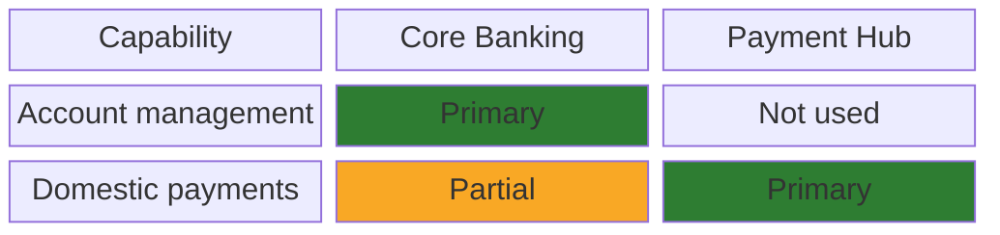
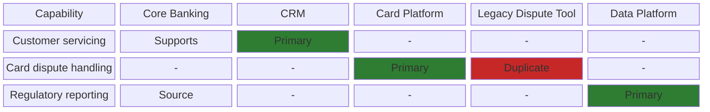

# Business–Application Alignment (Capability-Service Map) Diagram

Mermaid type: `block-beta` (Close fit). Source: Modeling-Diagraming.md, section "Enterprise Architecture & Business Strategy".

Maps business capabilities, processes, and services to supporting applications, showing which applications support which business functions and where gaps or redundant systems exist.

## Example 1: Simple - capability to application grid

## Example 2: Realistic - card dispute capability with a duplicate application

