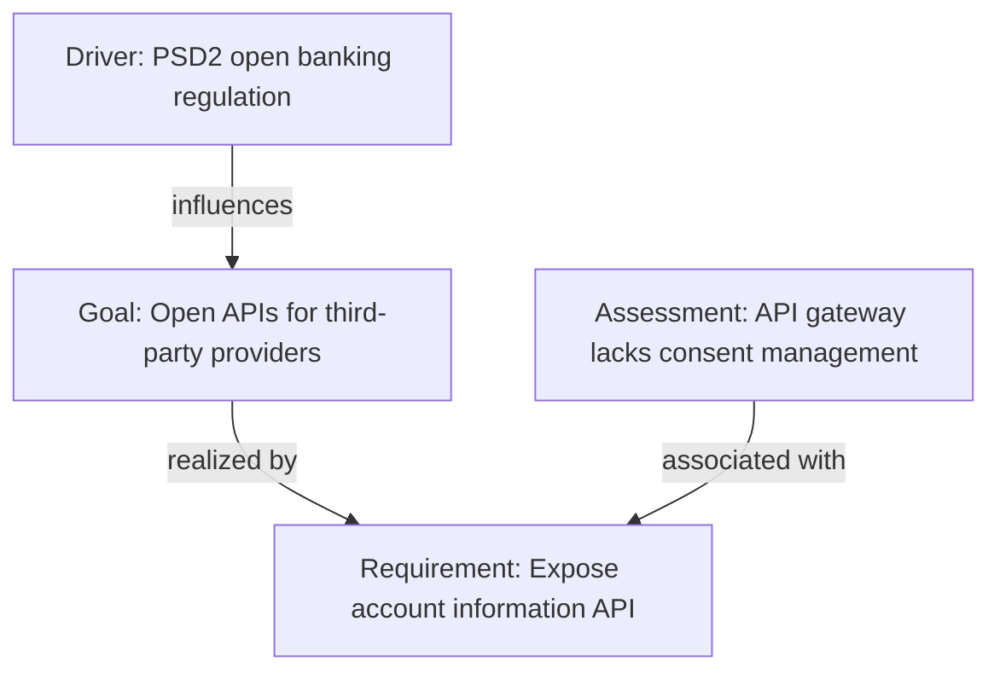
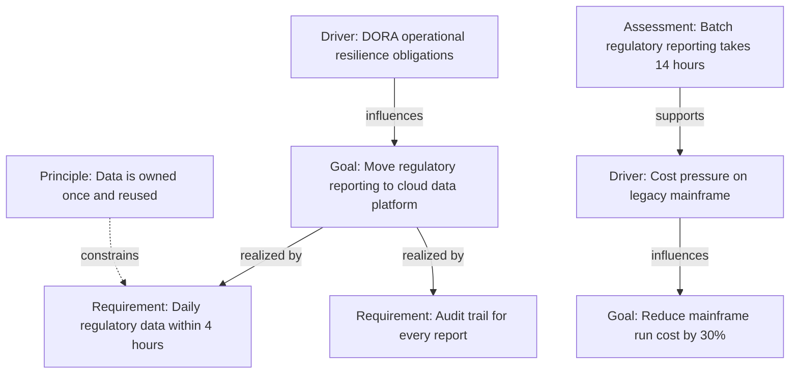

# Business Motivation Diagram (ArchiMate)

Mermaid type: `flowchart` (Close fit). Source: Modeling-Diagraming.md, section "Enterprise Architecture & Business Strategy".

Connects stakeholders, drivers, assessments, goals, outcomes, principles, and requirements to answer why the architecture is changing and which objectives, pressures, and constraints justify the change.

## Example 1: Simple - regulation driving an open-API goal

## Example 2: Realistic - cost and compliance drivers

