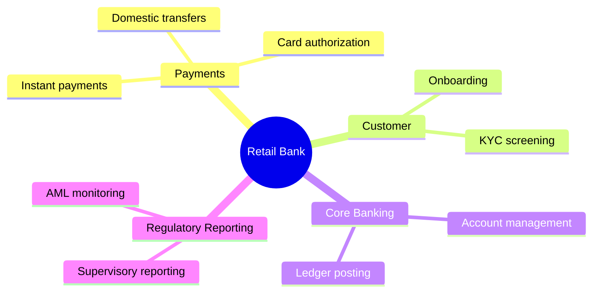
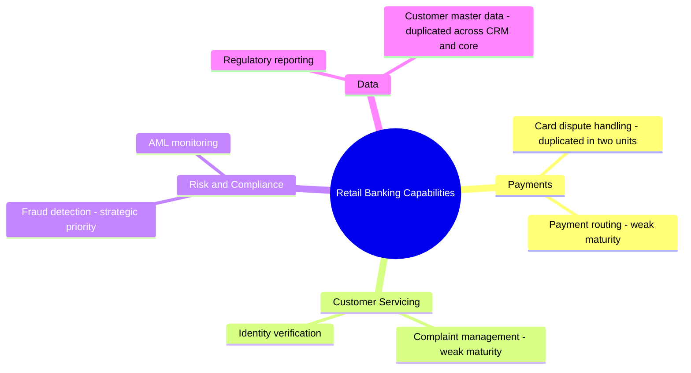

# Capability Map (ArchiMate)

Mermaid type: `mindmap` (Close fit). Source: Modeling-Diagraming.md, section "Enterprise Architecture & Business Strategy".

Shows what the organization must be able to do, independent of its structure, and which capabilities are missing, duplicated, weak, or strategically important.

## Example 1: Simple - L1/L2 capability tree

## Example 2: Realistic - duplicated and weak capabilities

