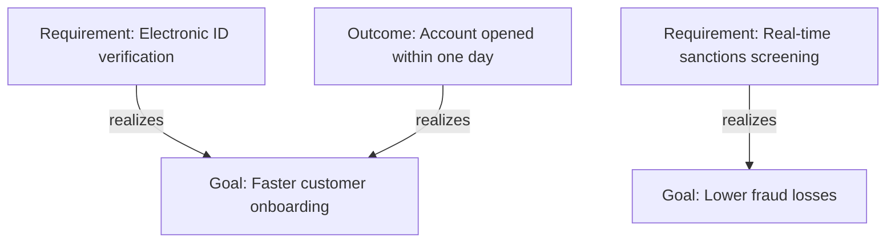
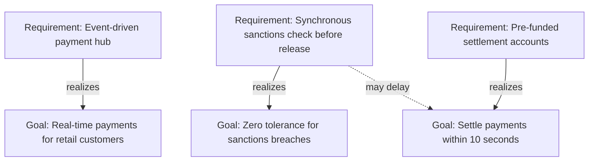

# Goal Realization Diagram (ArchiMate)

Mermaid type: `flowchart` (Close fit). Source: Modeling-Diagraming.md, section "Enterprise Architecture & Business Strategy".

Shows how goals are refined and supported by outcomes, requirements, and other goals, answering how architectural requirements contribute to business objectives.

## Example 1: Simple - requirements realizing goals

## Example 2: Realistic - conflicting goals in a payment hub

