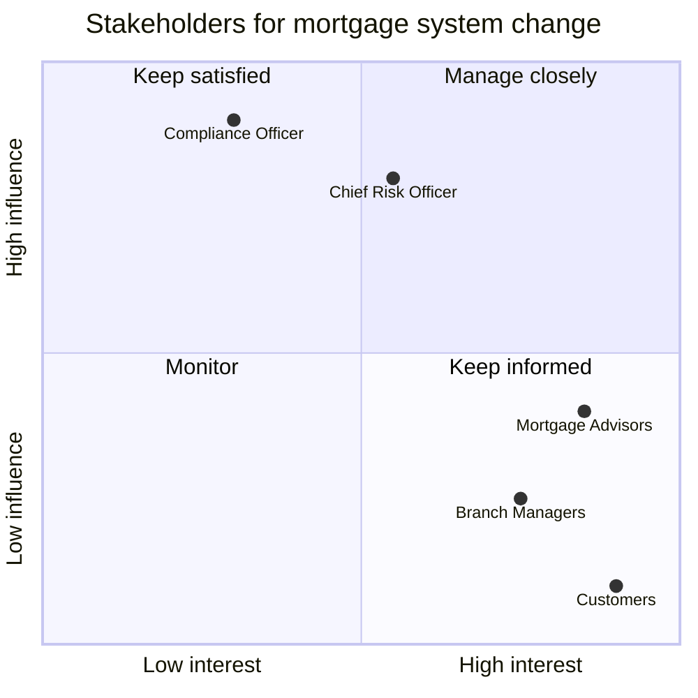
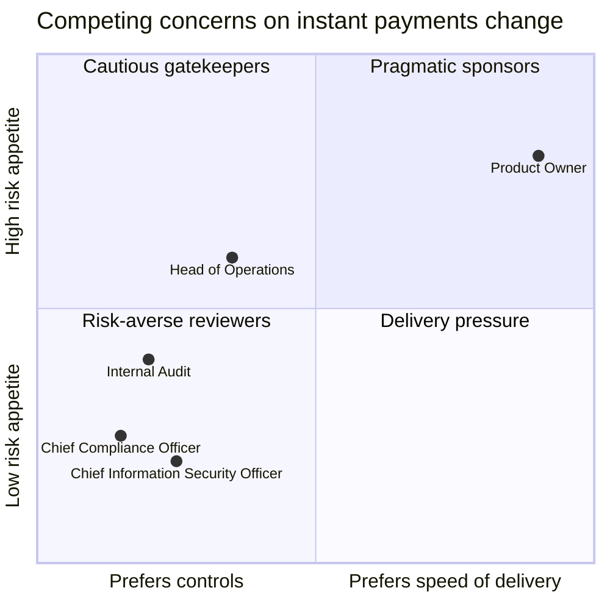

# Stakeholder Viewpoint (ArchiMate)

Mermaid type: `quadrantChart` (Close fit). Source: Modeling-Diagraming.md, section "Enterprise Architecture & Business Strategy".

Maps stakeholders to their concerns, drivers, and desired outcomes to show who cares about the change and which competing interests must be reconciled.

## Example 1: Simple - influence vs interest

## Example 2: Realistic - competing concerns on an instant payments change

