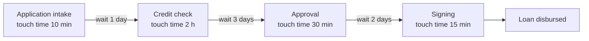
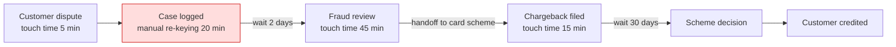

# Value Stream Map (ArchiMate / business architecture)

Mermaid type: `flowchart` (Close fit). Source: Modeling-Diagraming.md, section "Enterprise Architecture & Business Strategy".

Models the stages through which the organization creates value for customers, showing where value is created and where delays, handoffs, and improvement opportunities sit.

## Example 1: Simple - loan origination

## Example 2: Realistic - card dispute handling

