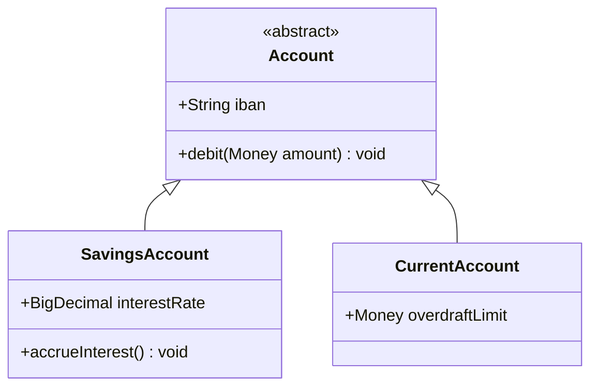
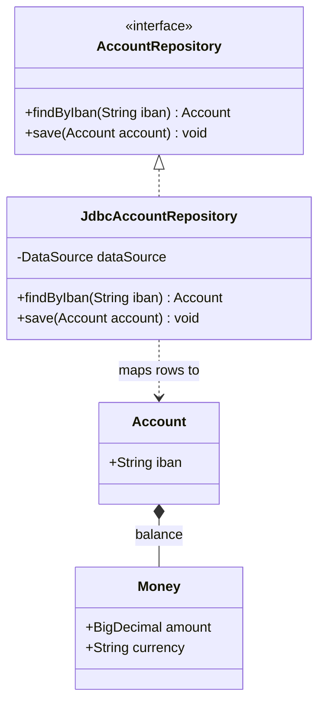

# Code Diagram (C4 Level 4)

Mermaid type: `classDiagram` (Close fit). Source: Modeling-Diagraming.md, section "System Context, Boundaries & Decomposition".

Describes implementation structures using classes, interfaces, and their relationships, showing how a component is implemented.

## Example 1: Simple - account hierarchy

## Example 2: Realistic - account repository with JDBC implementation

