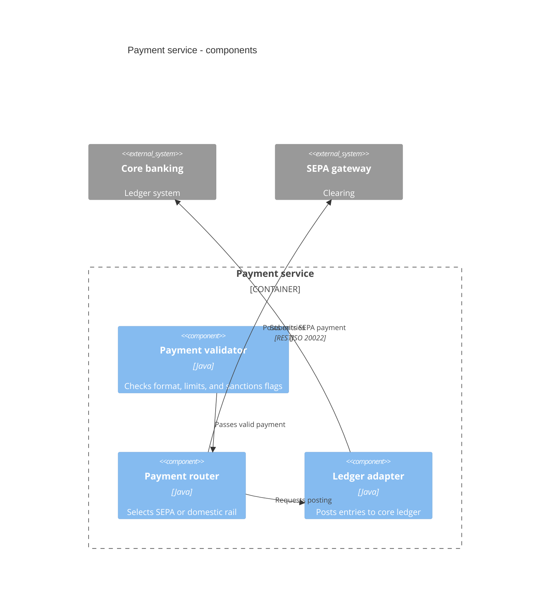
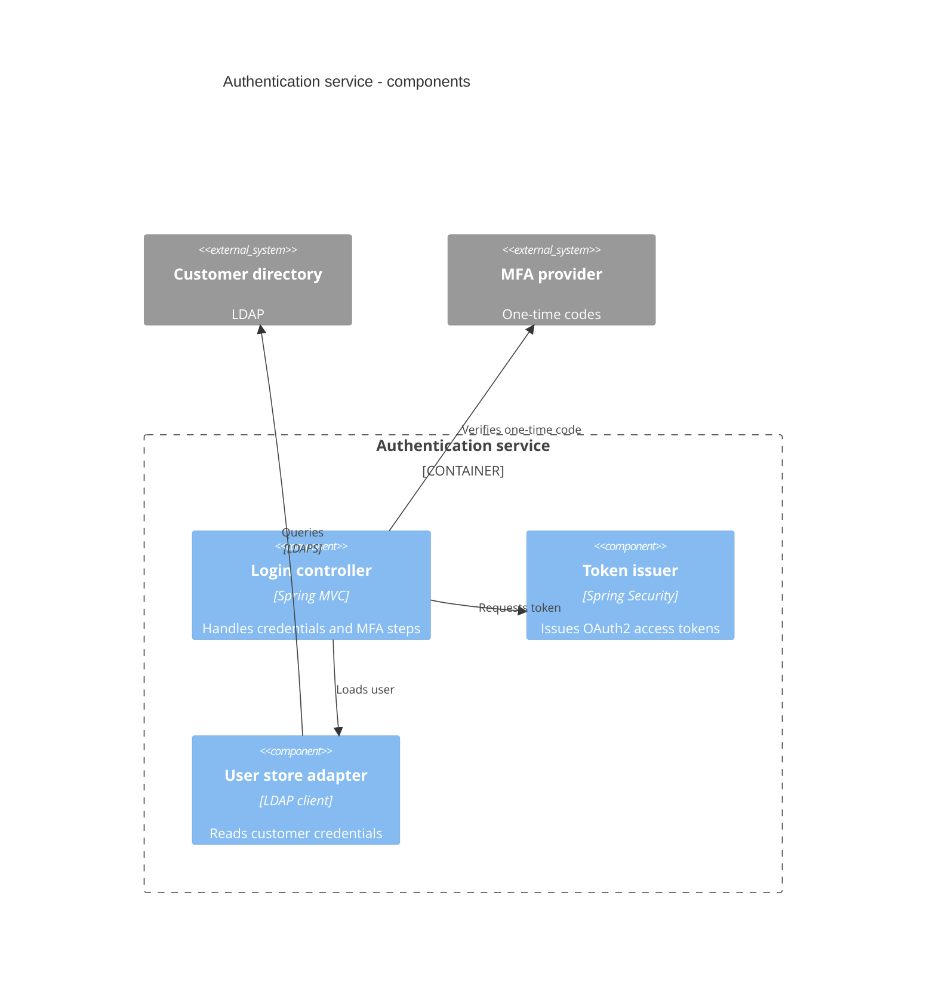

# Component Diagram (C4 Level 3)

Mermaid type: `C4Component` (Native fit). Source: Modeling-Diagraming.md, section "System Context, Boundaries & Decomposition".

Shows the major logical components inside a particular application or service, and how they interface and depend on each other.

## Example 1: Simple - payment service

## Example 2: Realistic - authentication service

