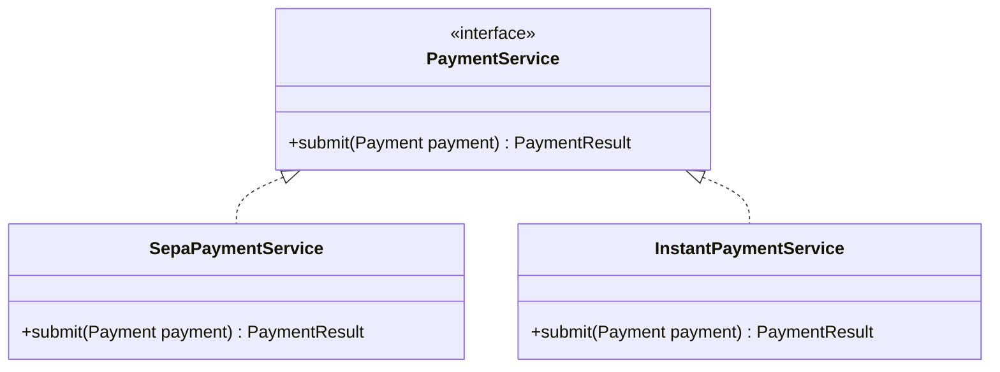
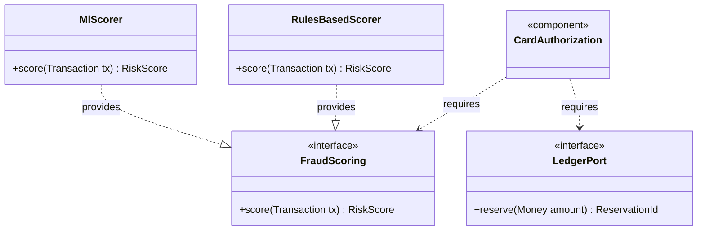

# Component Diagram (UML)

Mermaid type: `classDiagram` with `<<interface>>` and `<<component>>` (Close fit). Source: Modeling-Diagraming.md, section "Boundaries & Decomposition".

Models components with provided and required interfaces and their dependency relationships, showing what contracts connect them.

## Example 1: Simple - payment service with two implementations

## Example 2: Realistic - replaceable fraud scoring component

