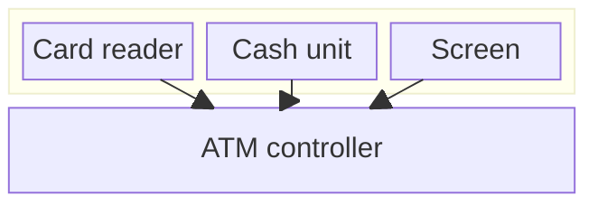
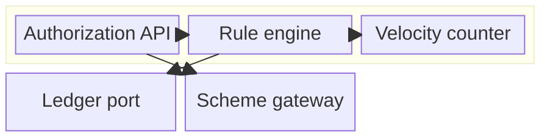

# Composite Structure Diagram (UML)

Mermaid type: `block-beta` (Approximate fit). Source: Modeling-Diagraming.md, section "Boundaries & Decomposition".

Source gives no description for this item. The diagram shows a system built from nested parts and the connections between them.

## Example 1: Simple - ATM with parts

## Example 2: Realistic - card authorization engine

