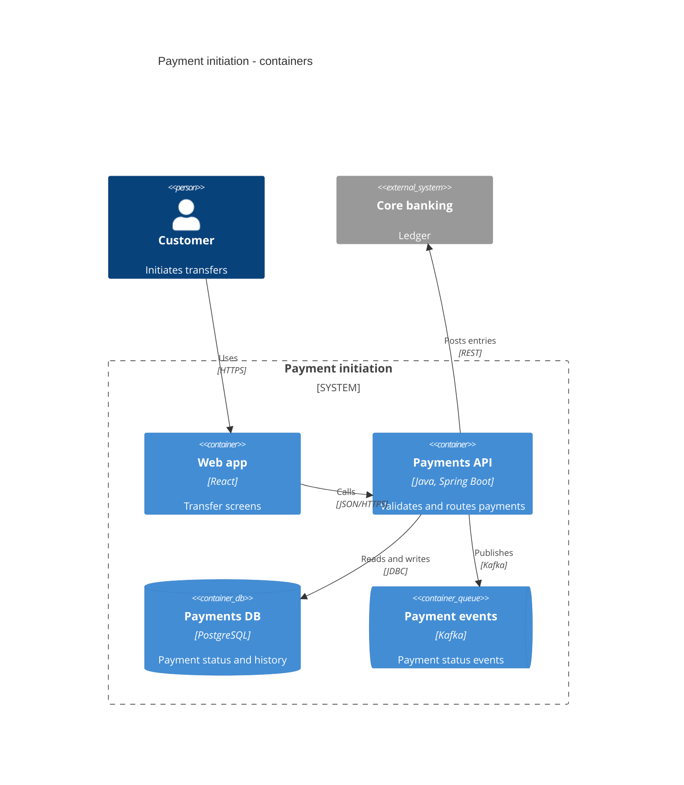
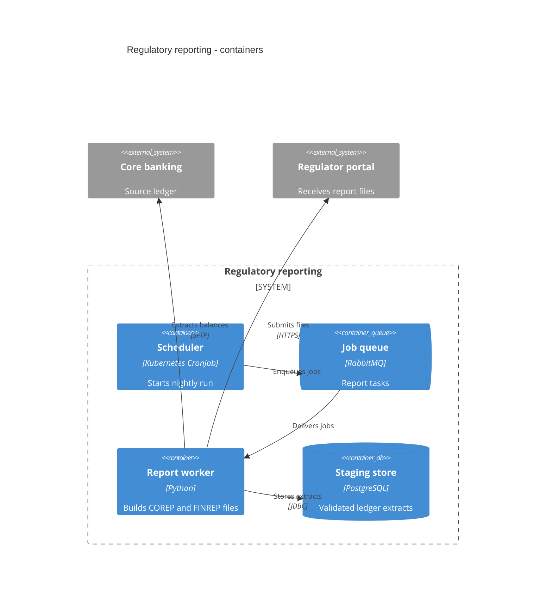

# Container Diagram (C4 Level 2)

Mermaid type: `C4Container` (Native fit). Source: Modeling-Diagraming.md, section "System Context, Boundaries & Decomposition".

Decomposes a system into applications, services, databases, and other runnable or storage units.

## Example 1: Simple - payment initiation

## Example 2: Realistic - regulatory reporting

