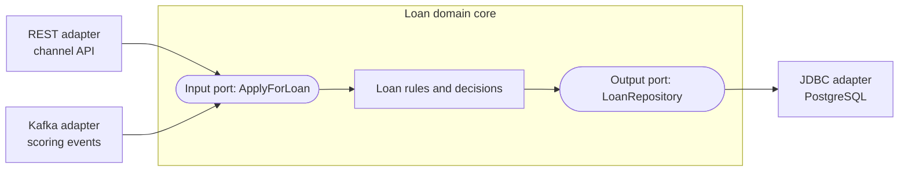
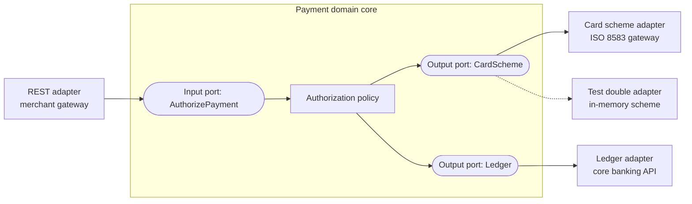

# Hexagonal / Ports-and-Adapters Diagram

Mermaid type: `flowchart` (Approximate fit). Source: Modeling-Diagraming.md, section "Boundaries & Decomposition".

Source gives no description for this item. The diagram shows a core domain isolated from external systems through input and output ports, with adapters plugged into those ports.

## Example 1: Simple - loan domain core with REST and Kafka adapters

## Example 2: Realistic - payment core with card scheme adapter and test double

