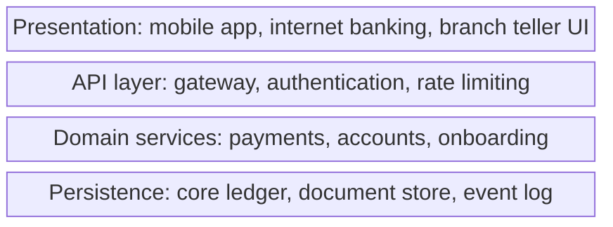
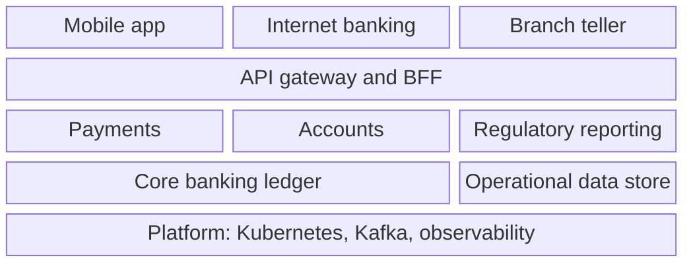

# Layered Architecture Diagram

Mermaid type: `block-beta` (Close fit). Source: Modeling-Diagraming.md, section "Boundaries & Decomposition".

Source gives no description for this item. The diagram shows a system organized into stacked layers, from channels down to persistence and platform.

## Example 1: Simple - four stacked layers

## Example 2: Realistic - channels, services, data, and platform

