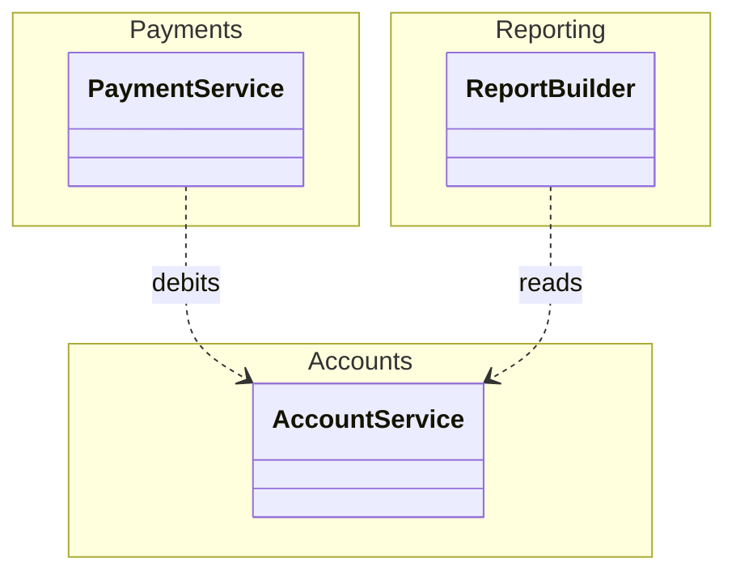
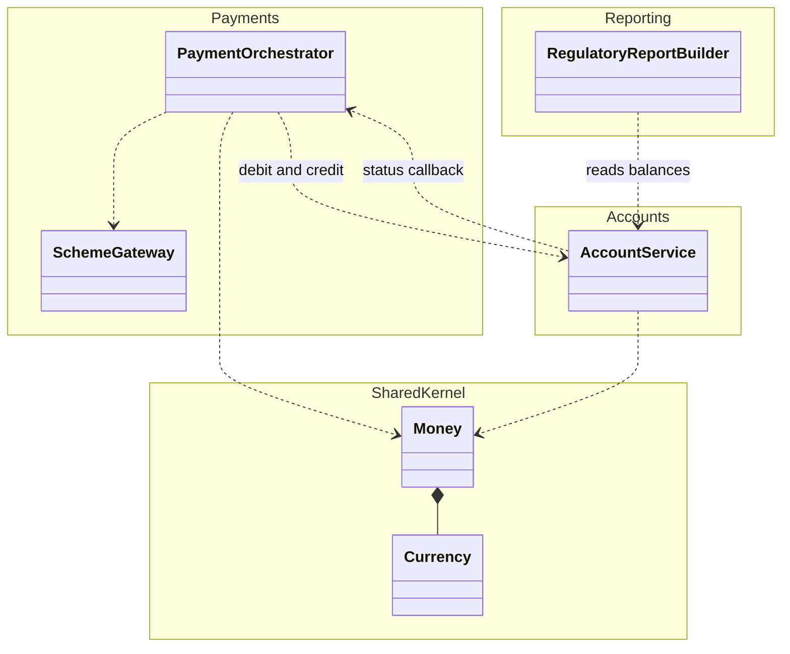

# Package Diagram (UML)

Mermaid type: `classDiagram` with `namespace` (Close fit). Source: Modeling-Diagraming.md, section "Boundaries & Decomposition".

Shows logical packages, namespaces, modules, and the dependencies between them, including dependency cycles.

## Example 1: Simple - payments, accounts, reporting

## Example 2: Realistic - module dependency cycle with shared kernel

