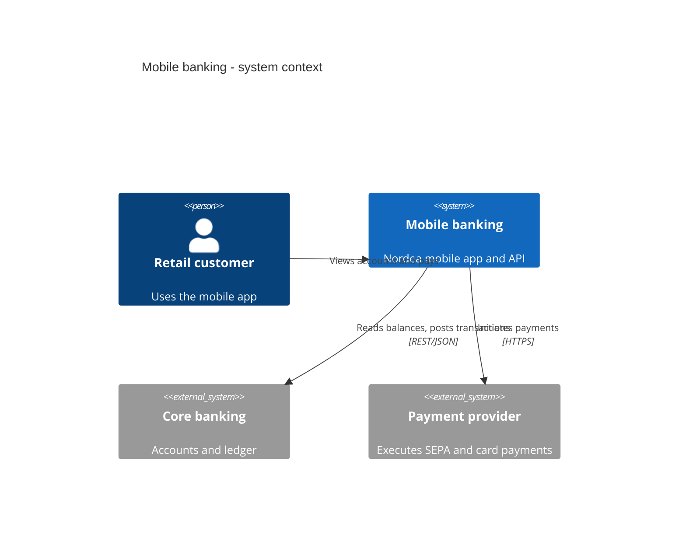
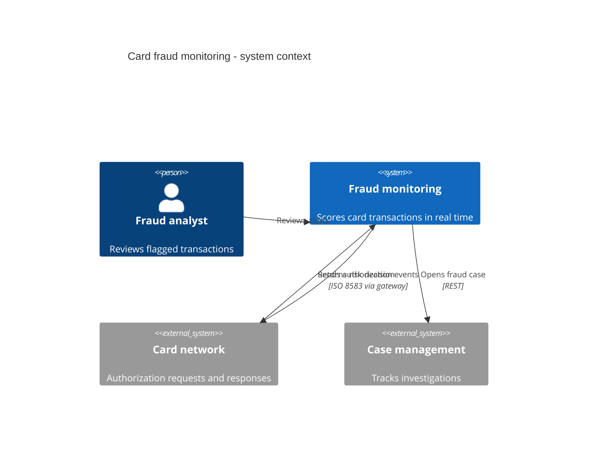

# System Context Diagram (C4 Level 1)

Mermaid type: `C4Context` (Native fit). Source: Modeling-Diagraming.md, section "System Context, Boundaries & Decomposition".

Shows one system in relation to its users, external systems, and integrations.

## Example 1: Simple - mobile banking

## Example 2: Realistic - card fraud monitoring

