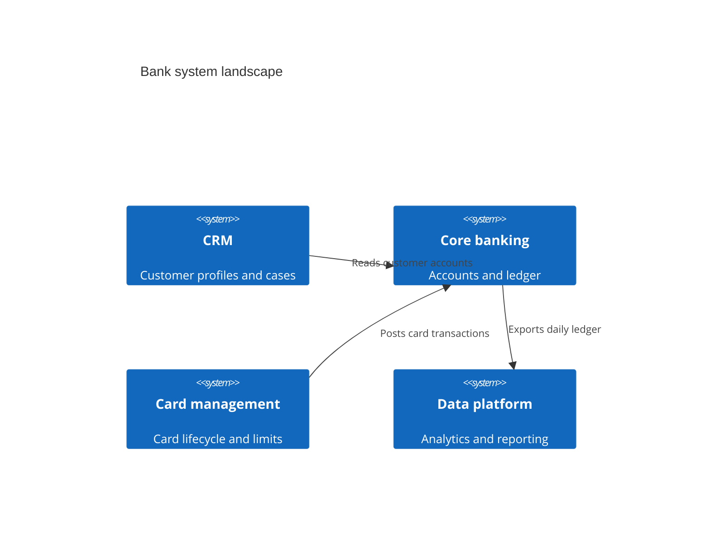
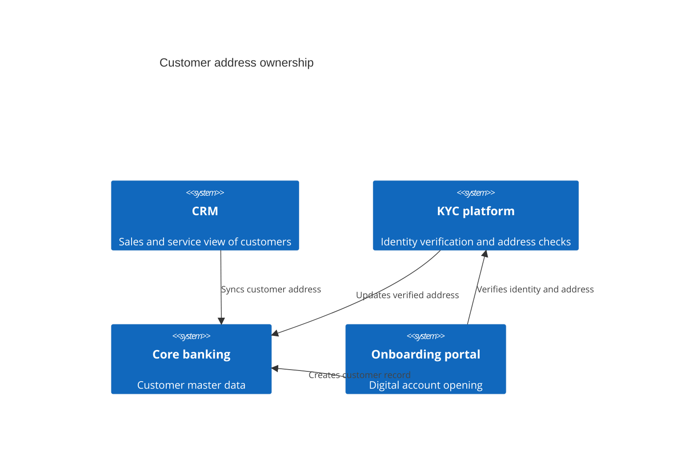

# System Landscape Diagram (C4)

Mermaid type: `C4Context` (Native fit). Source: Modeling-Diagraming.md, section "System Context, Boundaries & Decomposition".

Shows which software systems exist across the organization, how they depend on each other, and where responsibilities overlap.

## Example 1: Simple - bank systems

## Example 2: Realistic - overlapping customer address ownership

