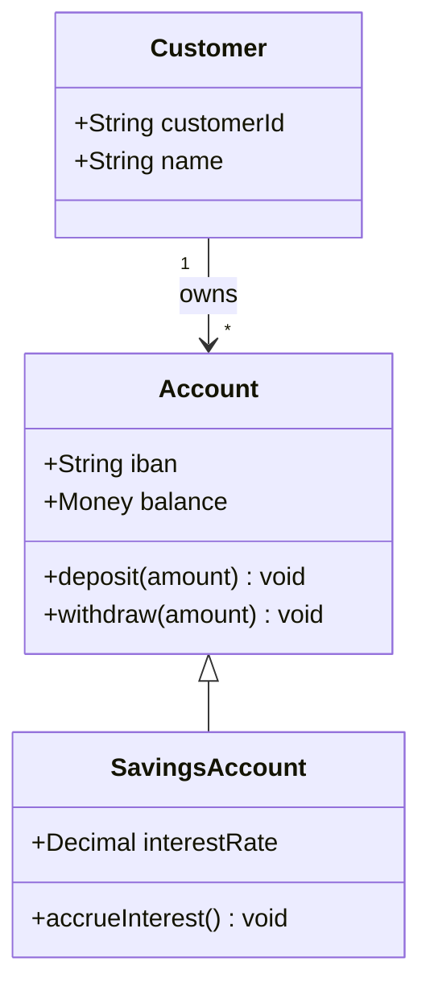
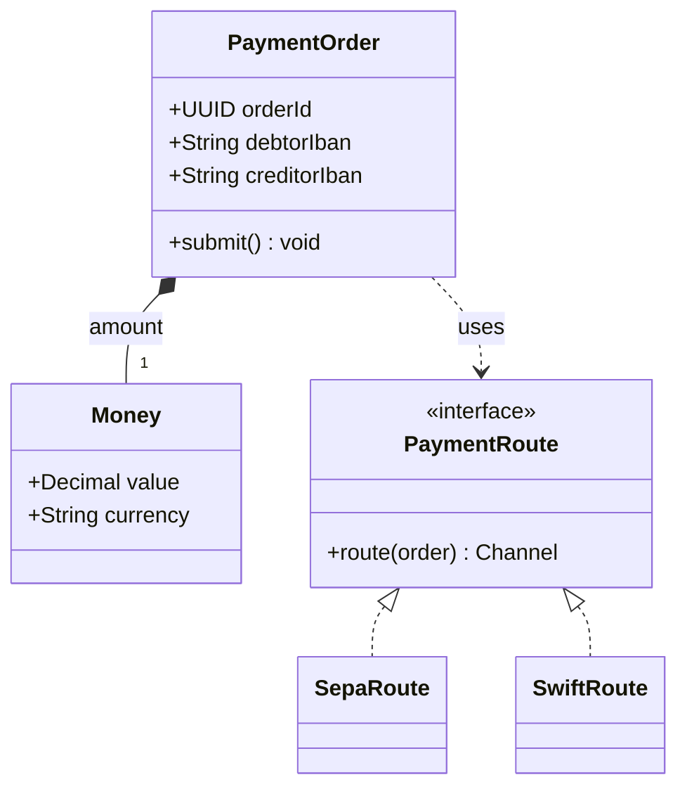

# Class Diagram (UML)

Mermaid type: `classDiagram` (Native fit). Source: Modeling-Diagraming.md, section "Software Structure, Object Models & Design".

The diagram answers what the types are and how they relate, and which abstractions own which responsibilities.

## Example 1: Simple - account inheritance

## Example 2: Realistic - payment routing

