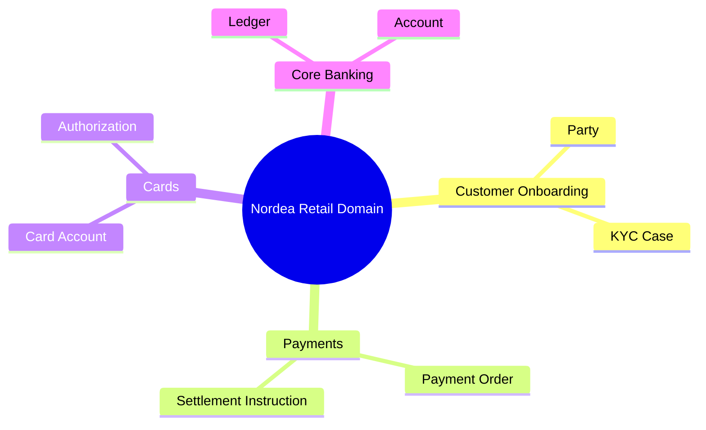
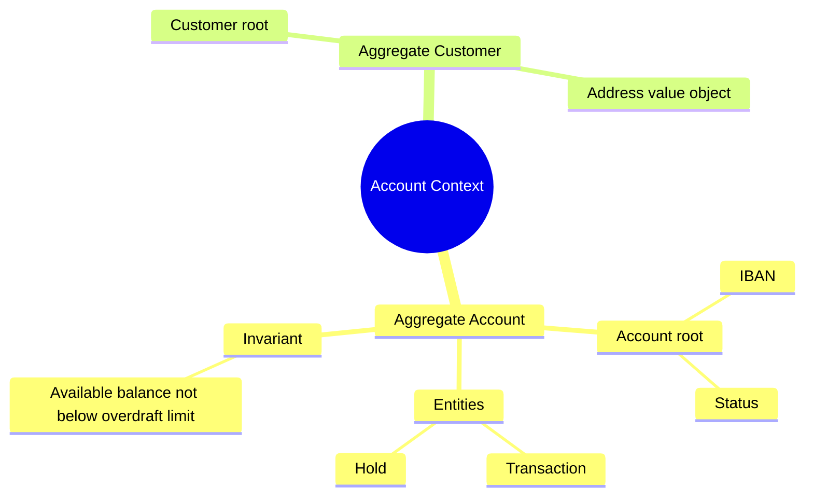

# Domain Driven Design

Mermaid type: `mindmap` (Approximate fit). Source: Modeling-Diagraming.md, section "Software Structure, Object Models & Design".

The file shows how the banking domain is split into bounded contexts and how an aggregate groups the entities that must change together.

## Example 1: Simple - bounded contexts

## Example 2: Realistic - account aggregate

