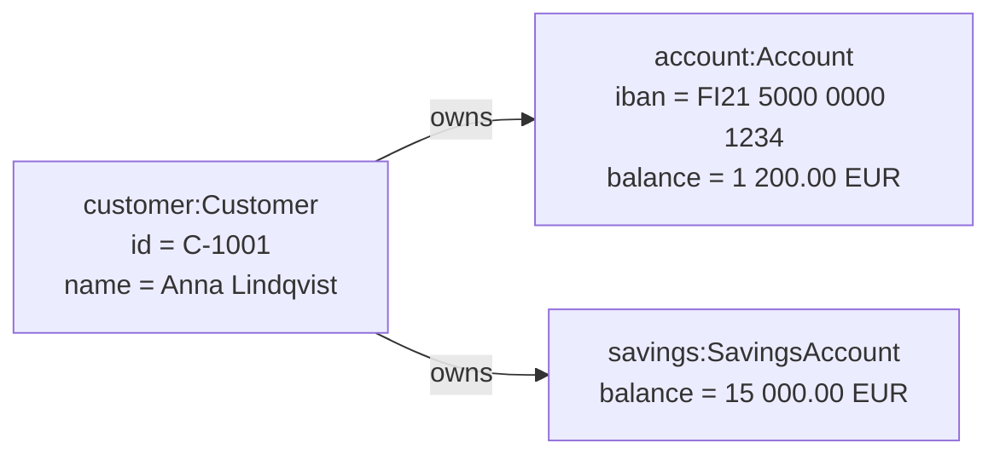
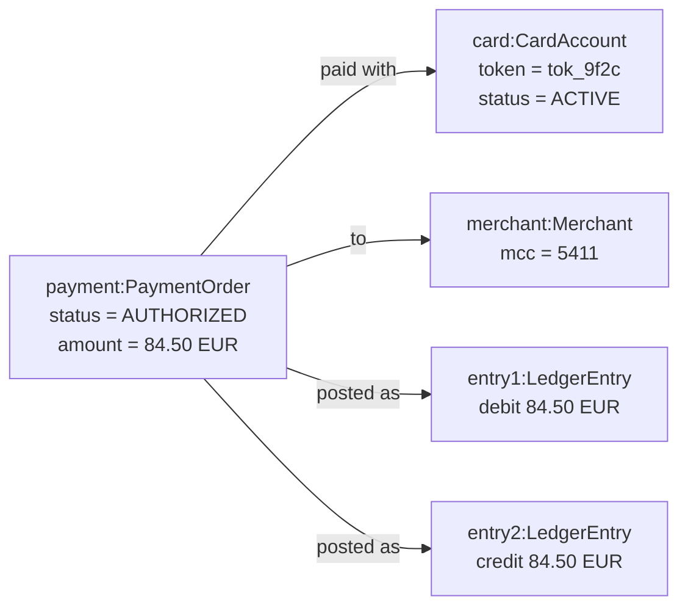

# Object Diagram (UML)

Mermaid type: `flowchart` (Approximate fit). Source: Modeling-Diagraming.md, section "Software Structure, Object Models & Design".

The diagram answers what a valid runtime object structure looks like and whether the model can represent a specific scenario.

## Example 1: Simple - customer snapshot

## Example 2: Realistic - card payment at a point in time

