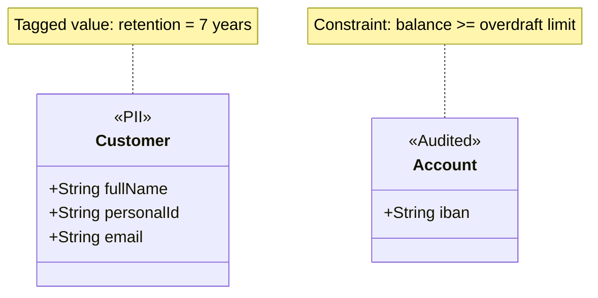
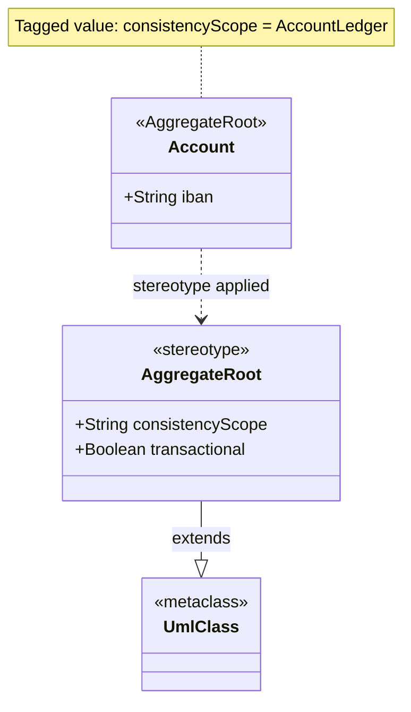

# Profile Diagram (UML)

Mermaid type: `classDiagram` (Approximate fit). Source: Modeling-Diagraming.md, section "Software Structure, Object Models & Design".

The diagram answers how standard UML concepts can be customized consistently for a particular domain.

## Example 1: Simple - data sensitivity stereotypes

## Example 2: Realistic - aggregate root profile

