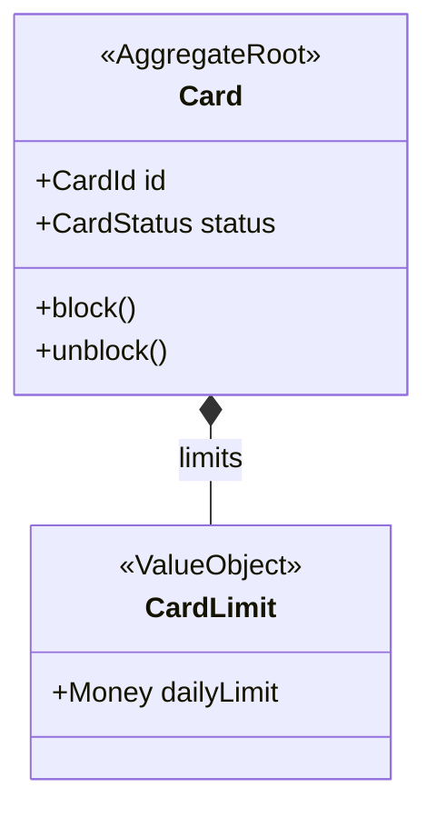
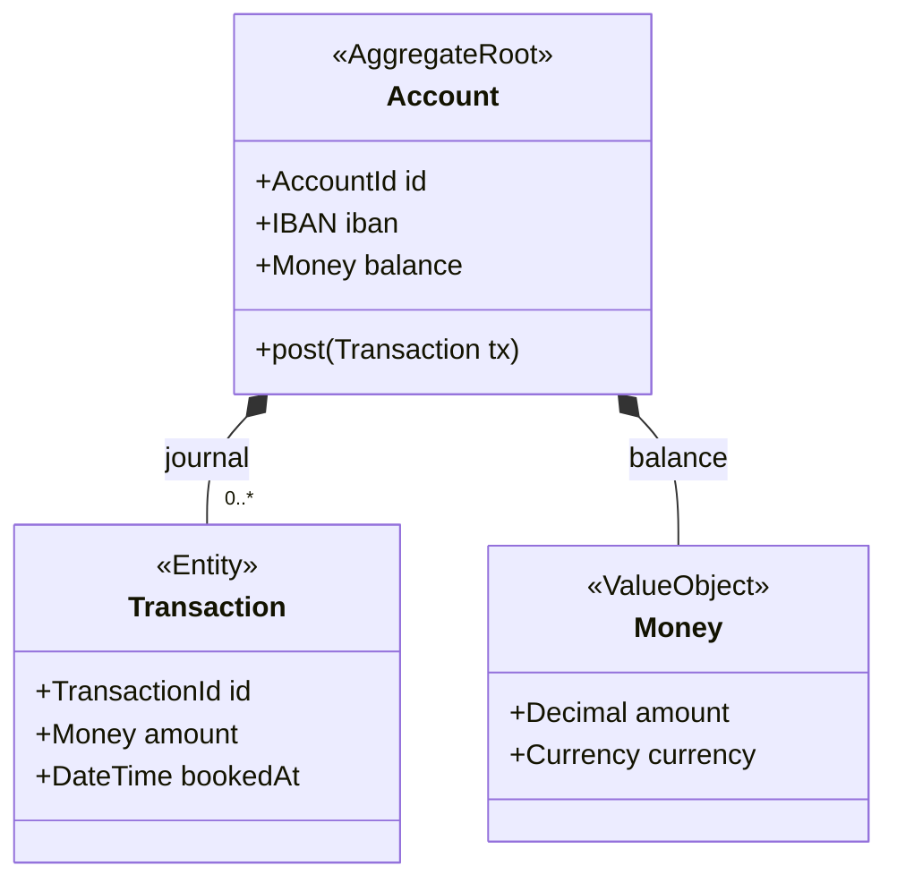

# Aggregate Diagram (DDD)

Mermaid type: `classDiagram` (Close fit). Source: Modeling-Diagraming.md, section "Pipe, Pipe, pipe ... - Shared, Ubiqitous Language - Busines <> Code".

Shows aggregate roots, internal entities, value objects, and consistency boundaries, answering what must change atomically and where transactional invariants are enforced.

## Example 1: Simple - Card aggregate

## Example 2: Realistic - Account with transaction journal

