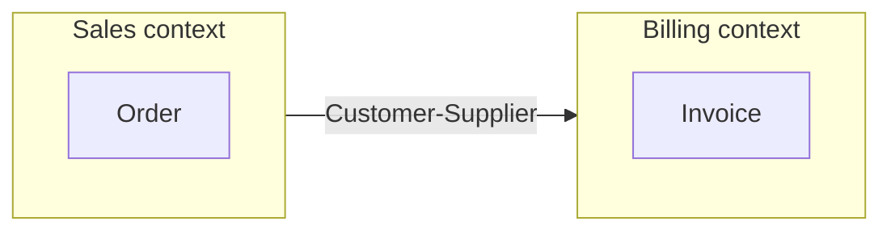
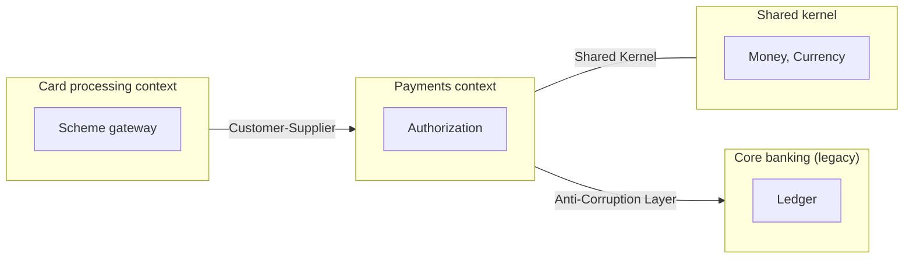

# Bounded Context Map (DDD)

Mermaid type: `flowchart` (Approximate fit). Source: Modeling-Diagraming.md, section "Pipe, Pipe, pipe ... - Shared, Ubiqitous Language - Busines <> Code".

Shows bounded contexts and relationships such as Customer-Supplier, Shared Kernel, or Anti-Corruption Layer, answering where model boundaries should exist and which teams or systems must translate concepts between contexts.

## Example 1: Simple - Sales and Billing

## Example 2: Realistic - Payments with shared kernel and legacy core

