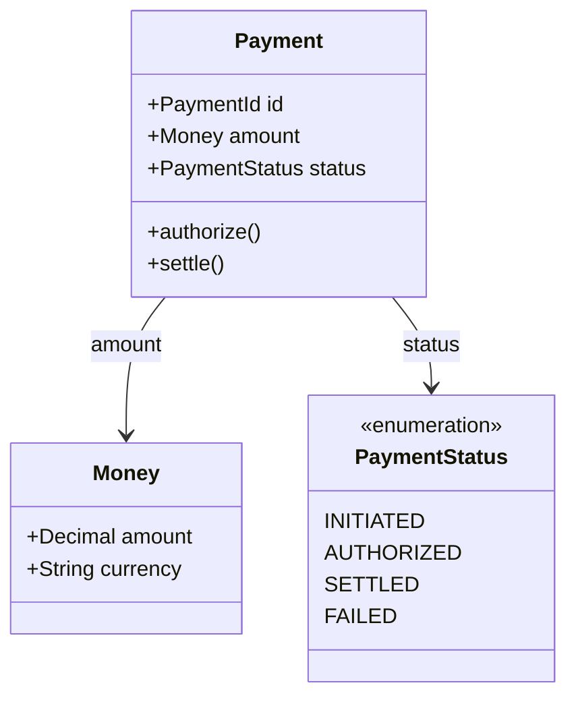
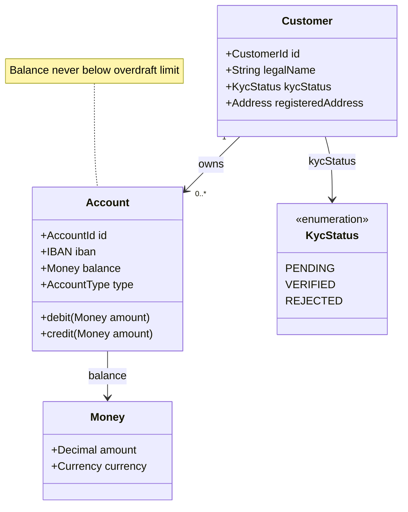

# Domain Model Diagram (DDD / UML-like)

Mermaid type: `classDiagram` (Native fit). Source: Modeling-Diagraming.md, section "Pipe, Pipe, pipe ... - Shared, Ubiqitous Language - Busines <> Code".

Represents business concepts, relationships, invariants, and shared vocabulary, answering what concepts exist in the problem domain and which distinctions matter to business rules.

## Example 1: Simple - Payment status

## Example 2: Realistic - Customer onboarding and accounts

