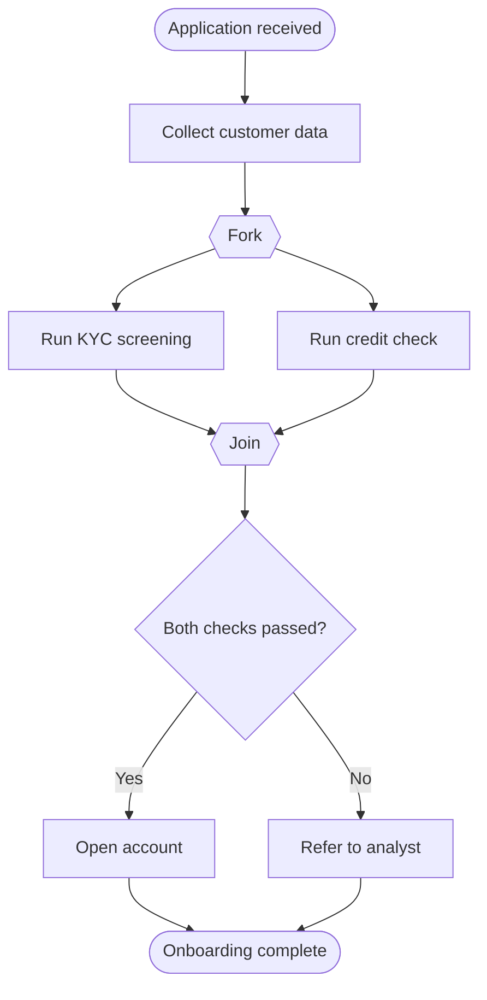
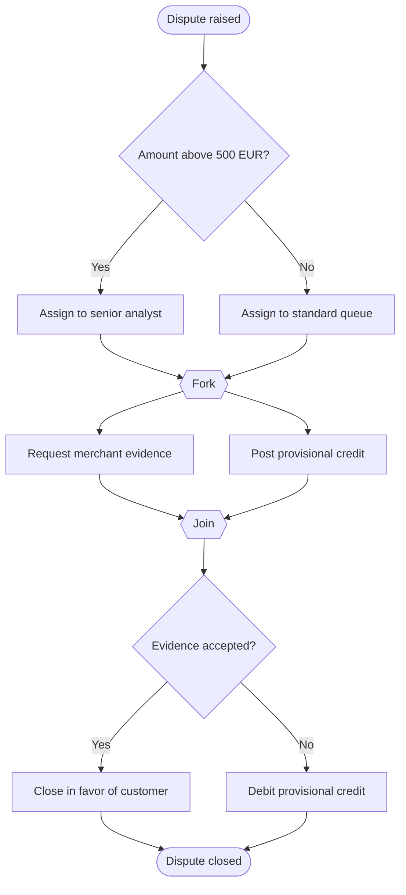

# Activity Diagram (UML)

Mermaid type: `flowchart` (Close fit). Source: Modeling-Diagraming.md, section "Runtime Behavior, Interactions & State".

Shows control flow, decisions, concurrent activities, and object flows, answering which steps run, which branches exist, and what work can happen in parallel.

## Example 1: Simple - Customer onboarding with parallel checks

## Example 2: Realistic - Card dispute handling

