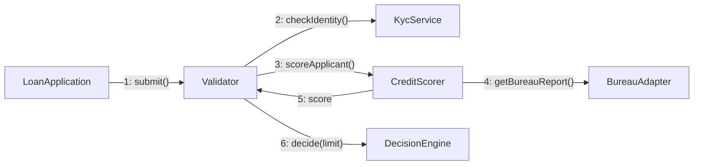
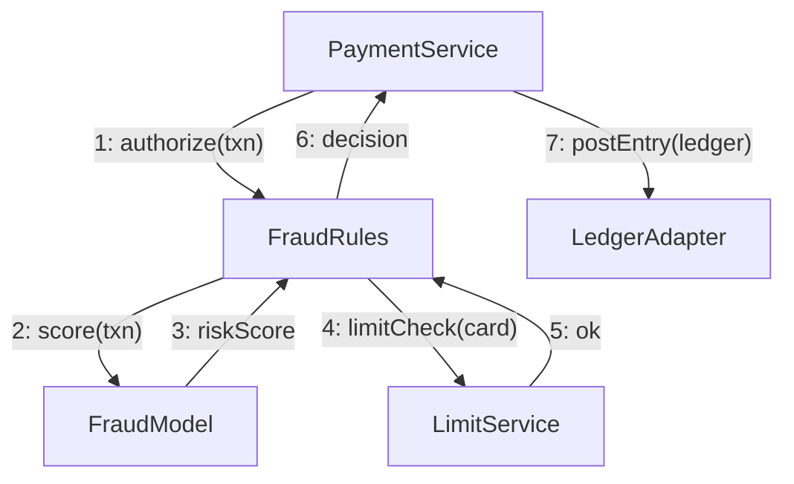

# Communication Diagram (UML)

Mermaid type: `flowchart` (Approximate fit). Source: Modeling-Diagraming.md, section "Runtime Behavior, Interactions & State".

Emphasizes collaborating objects and their message relationships with ordering labels, answering which objects communicate and how responsibilities are distributed.

## Example 1: Simple - Loan approval collaboration

## Example 2: Realistic - Card payment fraud check

