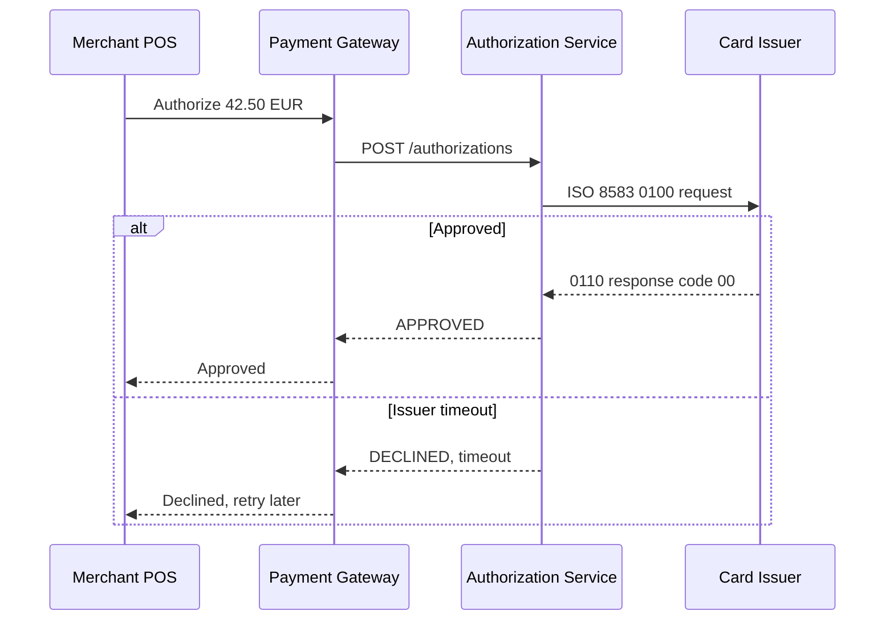
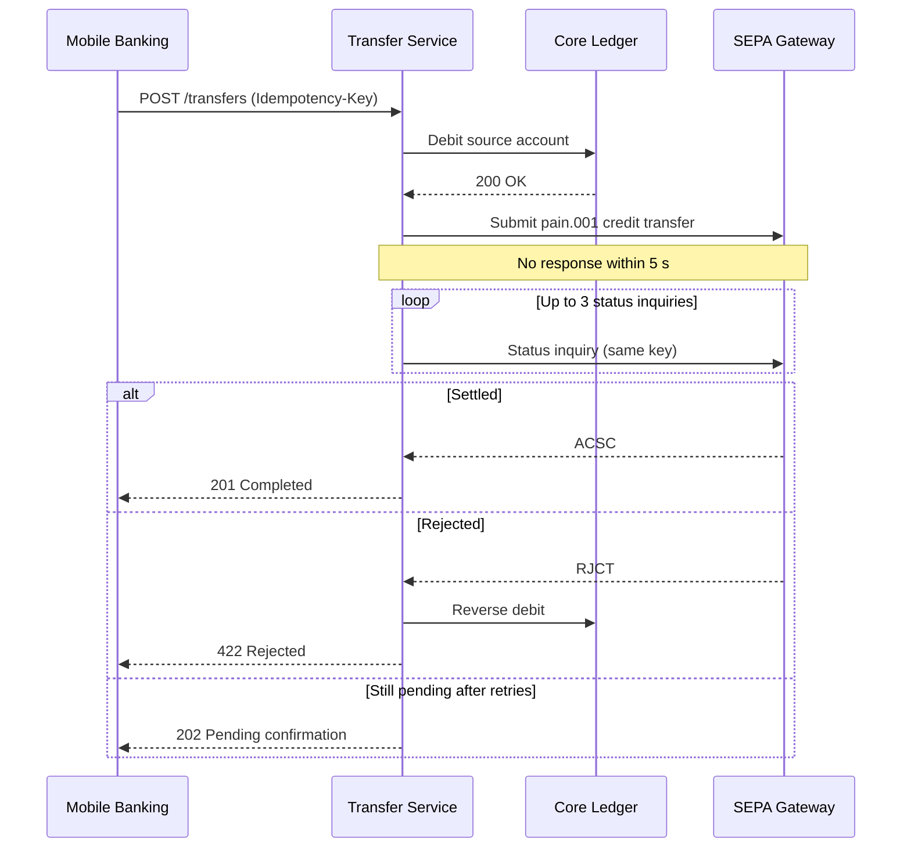

# Sequence Diagram (UML)

Mermaid type: `sequenceDiagram` (Native fit). Source: Modeling-Diagraming.md, section "Runtime Behavior, Interactions & State".

Shows messages exchanged between participants in chronological order, answering who calls whom and where retries, timeouts, and failures occur.

## Example 1: Simple - Card payment authorization

## Example 2: Realistic - SEPA transfer with timeout and retry

