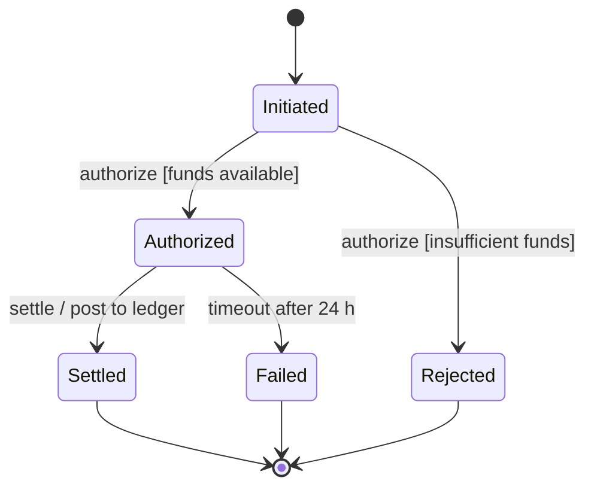
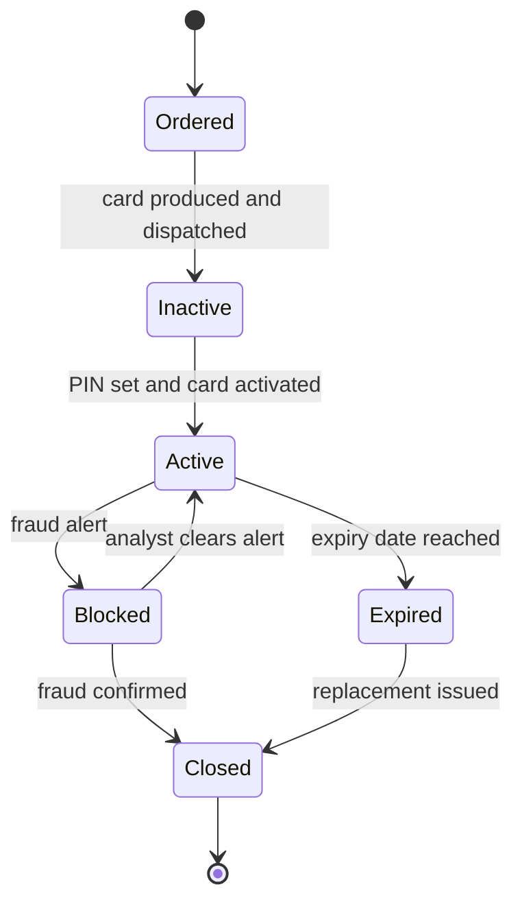

# State Machine Diagram (UML)

Mermaid type: `stateDiagram-v2` (Native fit). Source: Modeling-Diagraming.md, section "Runtime Behavior, Interactions & State".

Models states, events, guards, actions, and transitions for an entity, answering which states are valid and which transitions are permitted.

## Example 1: Simple - Payment states

## Example 2: Realistic - Payment card lifecycle

