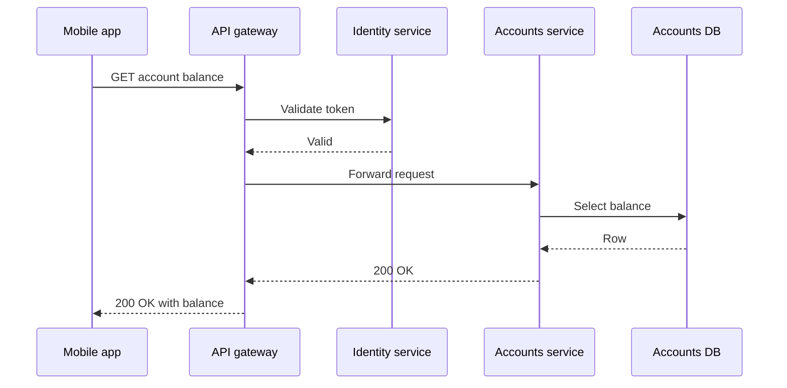
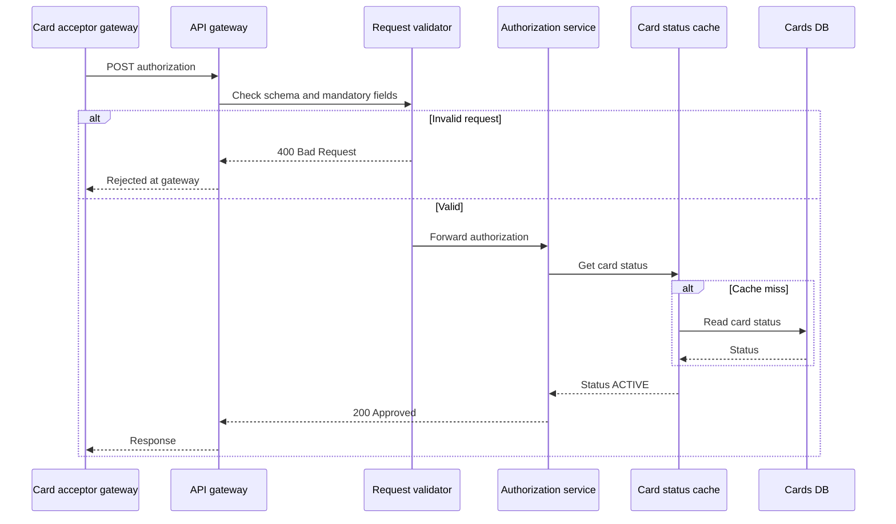

# Request Lifecycle Diagram

Mermaid type: `sequenceDiagram` (Close fit). Source: Modeling-Diagraming.md, section "Distributed systems".

Traces a request through authentication, validation, orchestration, processing, storage, and response generation.

## Example 1: Simple - Account balance query through gateway

## Example 2: Realistic - Card authorization with early rejection and cache path

