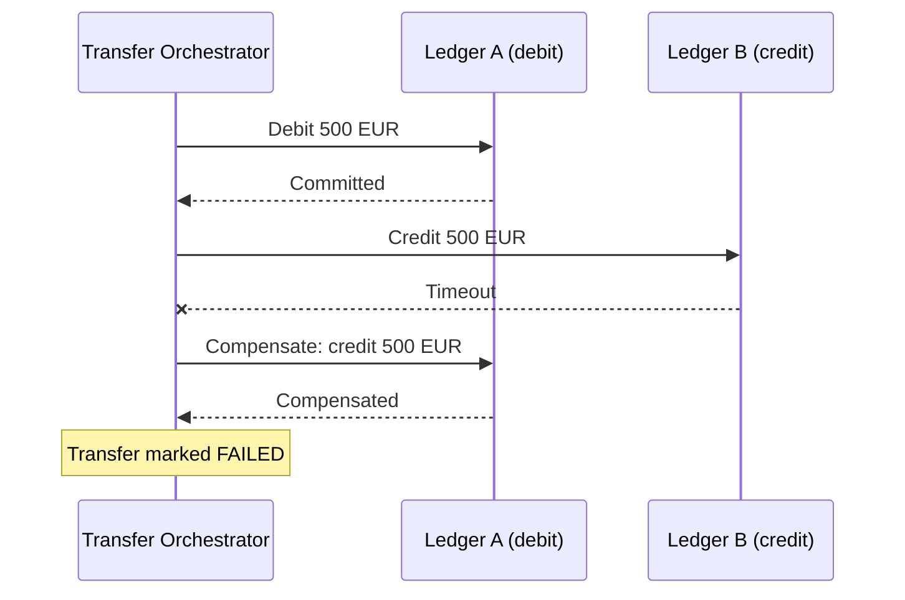
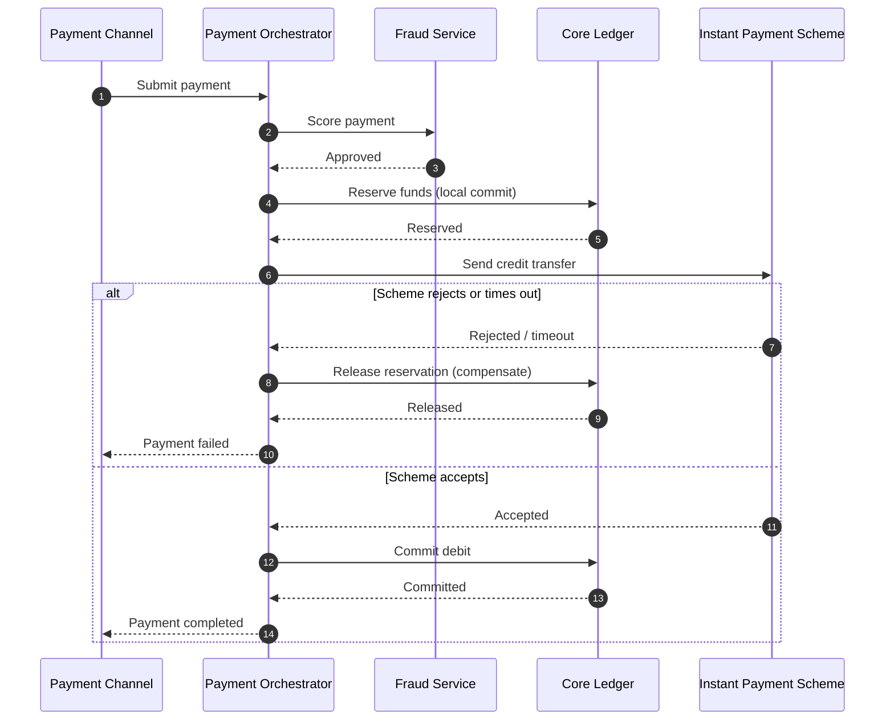

# Saga / Distributed Transaction Diagram

Mermaid type: `sequenceDiagram` (Close fit). Source: Modeling-Diagraming.md, section "Distributed systems".

Shows distributed transaction steps, local commits, compensations, and failure paths.

## Example 1: Simple - Transfer across two ledgers with compensation

## Example 2: Realistic - Instant payment with reservation and release

