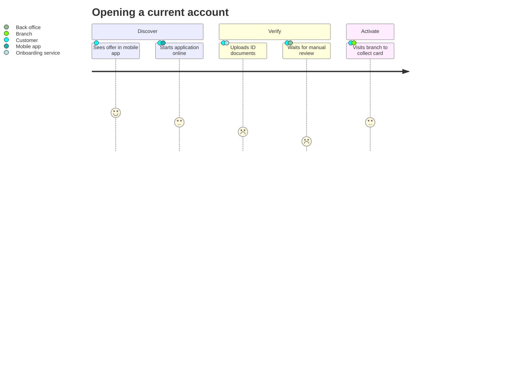
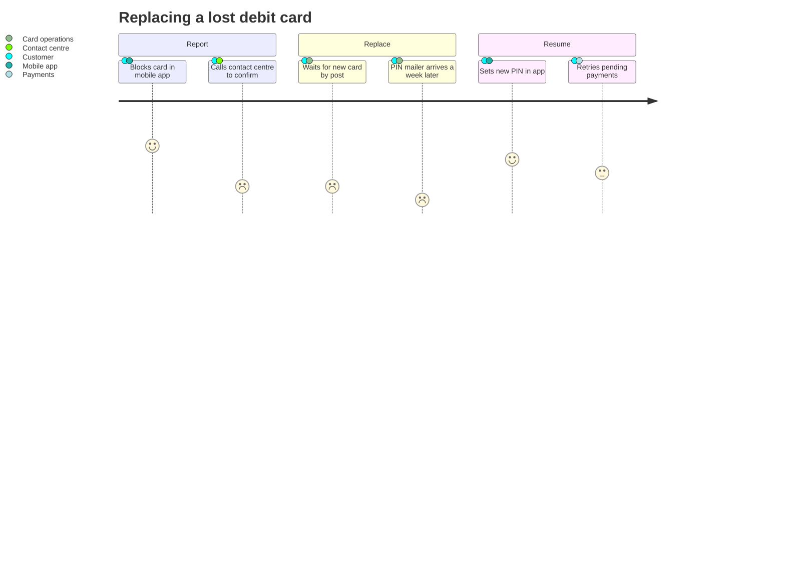

# Customer Journey Map

Mermaid type: `journey` (Native fit). Source: Modeling-Diagraming.md, section "Business Processes, Workflows & Decisions".

It answers what the customer experiences across channels and where organizational or system boundaries harm that experience.

## Example 1: Simple - Opening a current account across app and branch

## Example 2: Realistic - Replacing a lost debit card

