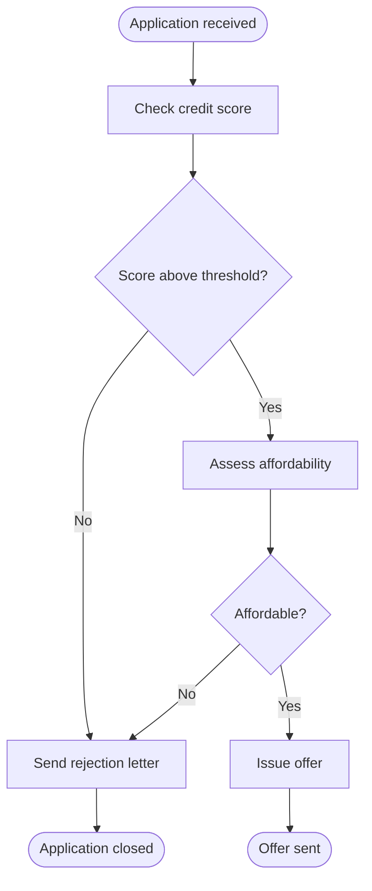
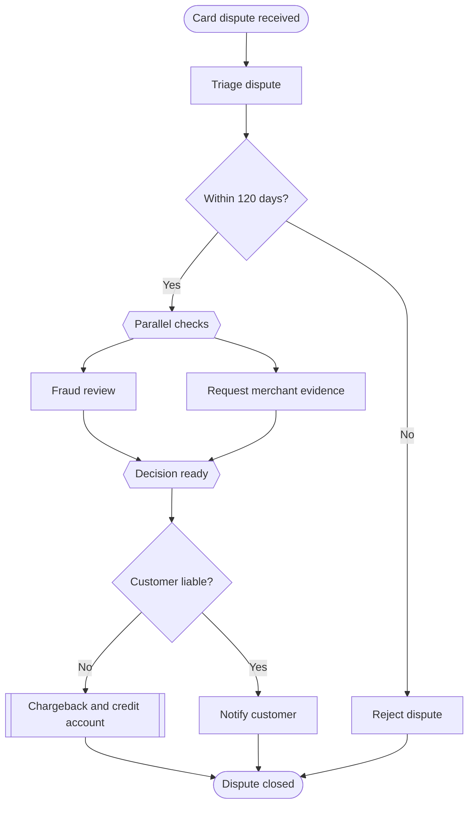

# Process Diagram (BPMN)

Mermaid type: `flowchart` (Approximate fit). Source: Modeling-Diagraming.md, section "Business Processes, Workflows & Decisions".

It answers how a business process works, what happens next, and where decisions, exceptions, and parallel activities occur.

## Example 1: Simple - Consumer loan application

## Example 2: Realistic - Card dispute with parallel checks

