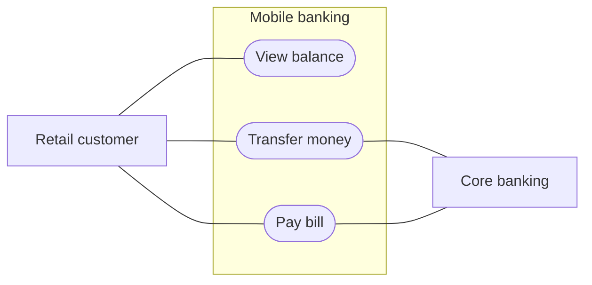
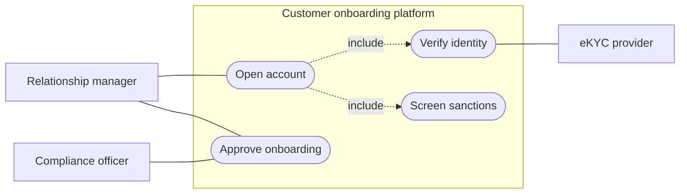

# Use Case Diagram (UML)

Mermaid type: `flowchart` (Approximate fit). Source: Modeling-Diagraming.md, section "Business Processes, Workflows & Decisions".

It answers what functionality the system exposes and who initiates or participates in each interaction.

## Example 1: Simple - Mobile banking customer

## Example 2: Realistic - Customer onboarding with include relations

