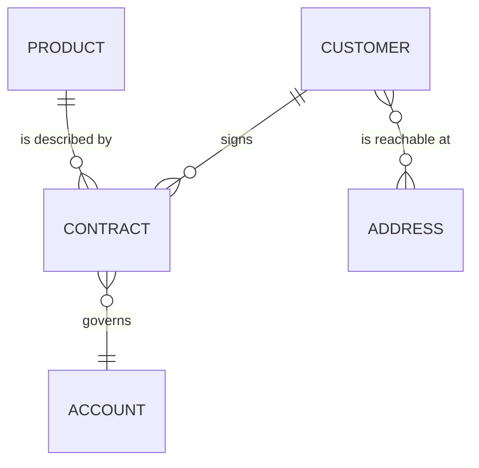
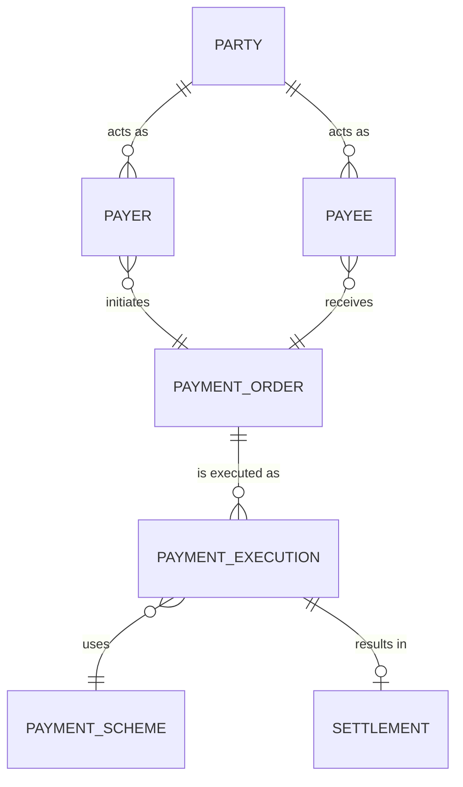

# Conceptual Data Model

Mermaid type: `erDiagram` (Native fit). Source: Modeling-Diagraming.md, section "Data Architecture & Information Modeling".

Shows the high-level business information concepts and their relationships, independent of database technology, so stakeholders agree on what each term means.

## Example 1: Simple - customer, product, contract

## Example 2: Realistic - party roles in payments

