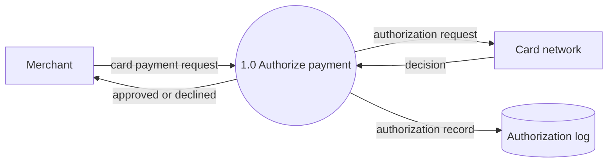
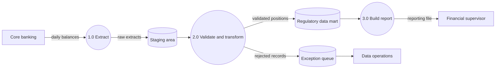

# Data Flow Diagram (DFD)

Mermaid type: `flowchart` (Close fit). Source: Modeling-Diagraming.md, section "Data Architecture & Information Modeling".

Shows where information originates, how it moves and is transformed through processes and data stores, and which flows cross system boundaries.

## Example 1: Simple - card payment authorization

## Example 2: Realistic - monthly regulatory reporting

