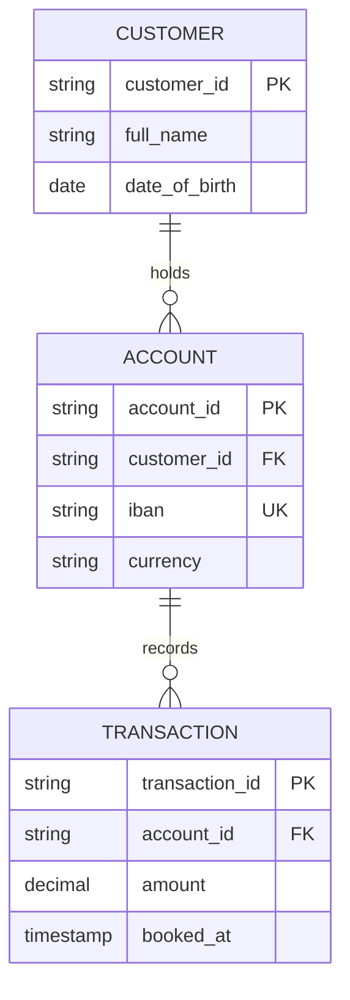
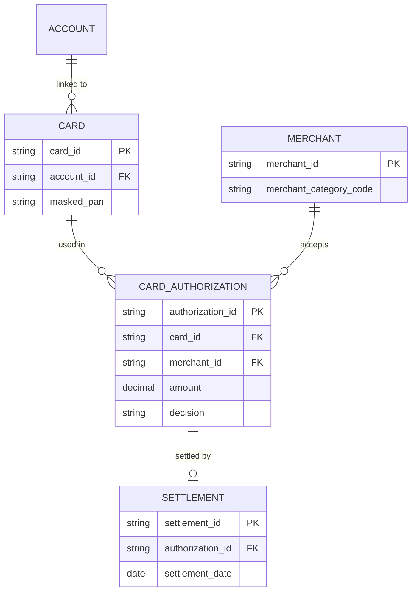

# Entity-Relationship Diagram (ERD)

Mermaid type: `erDiagram` (Native fit). Source: Modeling-Diagraming.md, section "Data Architecture & Information Modeling".

Shows which entities exist, how they relate, and which identifiers and integrity constraints must hold.

## Example 1: Simple - customer, account, transaction

## Example 2: Realistic - card authorization and settlement

